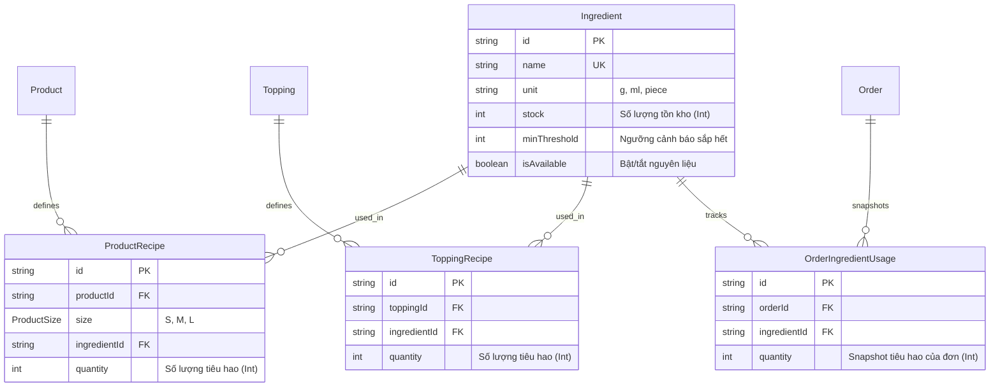

# TÀI LIỆU CHANGE REQUEST (CR-01): QUẢN LÝ TỒN KHO THEO NGUYÊN LIỆU

> **Mã CR:** CR-01  
> **Dự án:** BrewLite - Nền tảng Đặt Cà phê Trực tuyến  
> **Người lập:** Chiến (Leader / Architect)  
> **Ngày lập:** 27/10/2026  
> **Trạng thái:** ĐÃ PHÊ DUYỆT (GIAI ĐOẠN 1)  

---

## 1. BỐI CẢNH & MỤC TIÊU THAY ĐỔI

### 1.1. Yêu cầu mới từ Giảng viên hướng dẫn
- Các món trong thực đơn **phải được quản lý tồn kho dựa trên nguyên liệu (Ingredient-based Inventory / BOM - Bill of Materials)** thay vì trừ số lượng trực tiếp trên sản phẩm (`Product.stock`).
- Đặt món sẽ tiêu hao các nguyên liệu tương ứng với công thức pha chế của từng Size và Topping.
- Nếu bất kỳ nguyên liệu nào trong công thức không đủ số lượng tồn kho, đơn hàng không được phép tạo (trả về lỗi `400 Bad Request` kèm tên nguyên liệu bị thiếu).

### 1.2. Mục tiêu kỹ thuật Giai đoạn 1
1. **Chuẩn hóa F&B thực tế:** Không dùng đơn vị thô ("gói cà phê"), sử dụng đơn vị chuẩn: **gram (g)** cho bột/hạt/trà, **milliliter (ml)** cho chất lỏng/siro/sữa, và **cái/miếng (piece)** cho topping đóng hộp/lát hoa quả. Toàn bộ lưu dưới dạng **SỐ NGUYÊN (`Int`)** để loại trừ hoàn toàn sai số dấu phẩy động (`Float`).
2. **Hỗ trợ định lượng Size S/M/L & Topping:** Khi khách tăng size hoặc chọn topping, lượng tiêu hao nguyên liệu tăng theo đúng tỉ lệ pha chế (ví dụ: Size M tăng ~30–50% so với Size S; Size L tăng ~30–50% so với Size M).
3. **Cập nhật có điều kiện nguyên tử (D10):** Trừ kho nguyên liệu trực tiếp bằng truy vấn nguyên tử `stock >= qty` với `decrement: qty`. Gom nhu cầu theo `ingredientId` và sắp xếp tăng dần trước khi trừ để loại bỏ Deadlock giữa các transaction song song. Nguyên liệu **không dùng cột `version`** để tránh lỗi 400 giả mạo khi nhiều đơn hàng đặt đồng thời cùng loại nguyên liệu còn dồi dào.
4. **Snapshot hoàn kho (`OrderIngredientUsage`):** Khi đơn hàng bị hủy (`POST /orders/:id/cancel`), hệ thống hoàn kho dựa trên bảng snapshot `OrderIngredientUsage` đã lưu tại thời điểm tạo đơn, đảm bảo không phụ thuộc vào công thức sản phẩm tại thời điểm hủy.

---

## 2. QUY CHUẨN ĐỊNH LƯỢNG NGUYÊN LIỆU (F&B RECIPE STANDARD)

### 2.1. Đơn vị đo lường chuẩn (Base Units)
| Phân loại | Đơn vị lưu trữ | Kiểu dữ liệu | Ví dụ nguyên liệu |
| :--- | :---: | :---: | :--- |
| **Chất rắn / Bột** | `g` (gram) | `Int` | Hạt Cà phê Robusta/Arabica, Bột Matcha, Bột Cacao, Búp Trà Đen, Đường cát |
| **Chất lỏng** | `ml` (milliliter) | `Int` | Sữa tươi thanh trùng, Sữa đặc, Siro Đào, Nước cốt dừa, Kem béo |
| **Miếng / Cái / Lát** | `piece` (miếng/cái) | `Int` | Đào miếng ngâm, Thạch nha đam, Ly giấy/nhựa |

### 2.2. Bảng định lượng tiêu chuẩn mẫu (Seed Recipe Data)

#### A. Cà phê sữa truyền thống (Cà phê + Sữa đặc)
- **Size S (Tiêu chuẩn):** 18g hạt cà phê (1 shot espresso ~ 30ml) + 25ml sữa đặc.
- **Size M (Vừa, +38% cà phê, +40% sữa):** 25g hạt cà phê + 35ml sữa đặc.
- **Size L (Lớn, 2 shot espresso, +50% so với M):** 36g hạt cà phê + 50ml sữa đặc.

#### B. Cà phê đen đá (Cà phê + Đường)
- **Size S:** 18g hạt cà phê + 15g đường cát.
- **Size M:** 25g hạt cà phê + 20g đường cát.
- **Size L:** 36g hạt cà phê + 30g đường cát.

#### C. Trà đào cam sả (Trà đen + Siro đào + Đào miếng)
- **Size S:** 10g búp trà đen + 20ml siro đào + 1 miếng đào ngâm.
- **Size M:** 15g búp trà đen + 30ml siro đào + 2 miếng đào ngâm.
- **Size L:** 20g búp trà đen + 45ml siro đào + 3 miếng đào ngâm.

#### D. Topping chọn thêm
- **Trân châu trắng:** 30g trân châu.
- **Kem Cheese:** 40ml kem cheese.
- **Đào miếng thêm:** 2 miếng đào ngâm.

---

## 3. CÁC QUYẾT ĐỊNH ĐÃ CHỐT (D10 – D14)

- **D10 (Cơ chế trừ kho nguyên liệu):** Trừ kho nguyên liệu bằng cập nhật có điều kiện nguyên tử:
  ```sql
  UPDATE ingredients SET stock = stock - :qty WHERE id = :id AND stock >= :qty
  ```
  Trong Prisma: `tx.ingredient.updateMany({ where: { id, stock: { gte: qty } }, data: { stock: { decrement: qty } } })`.
  Gom toàn bộ nhu cầu theo `ingredientId`, sau đó sắp xếp danh sách `ingredientId` theo thứ tự alphabet tăng dần trước khi trừ để chống Deadlock. Bảng `Ingredient` **KHÔNG có cột `version`** (Optimistic Lock theo version ở cấp nguyên liệu sẽ gây xung đột 400 giả khi nhiều đơn đặt đồng thời dù kho còn thừa hàng trăm phần).
- **D11 (Định mức nguyên liệu):** Đơn vị tính là `g`, `ml`, `piece`, lưu `Int` không dùng số thực. Mỗi bậc size tăng ~30–50% so với bậc dưới, làm tròn số nguyên.
- **D12 (Hiển thị Menu):** HOÃN SANG GIAI ĐOẠN 2. Giai đoạn 1 giữ nguyên `GET /products`, không lọc tồn kho nguyên liệu.
- **D13 (Bảo toàn Schema cũ):** GIỮ NGUYÊN các trường `Product.stock`, `Product.version`, `Topping.stock` trong `schema.prisma`. Đánh dấu chú thích `DEPRECATED` (không còn được dùng để trừ kho hay check overselling). Không xóa cột bằng migration ở giai đoạn này để tránh xung đột ngược; sẽ xóa dứt điểm ở Giai đoạn 2 bằng migration riêng.
- **D14 (Kiểm tra giỏ hàng khả dụng):** HOÃN SANG GIAI ĐOẠN 2. Frontend giữ nguyên, không validate nguyên liệu tại client giỏ hàng.
- **Quy tắc Thanh toán thất bại & Hủy đơn:**
  - Thanh toán thất bại (`PAYMENT_FAILED`): **KHÔNG hoàn nguyên liệu** (khớp thiết kế D1: đơn vẫn ở trạng thái chờ thử lại thanh toán với cùng nguyên liệu đã giữ).
  - Hủy đơn (`POST /orders/:id/cancel` từ `PENDING` hoặc `PAYMENT_FAILED`): Hoàn nguyên liệu dựa trên snapshot bảng `OrderIngredientUsage`, không tính lại theo công thức hiện tại.
- **Xử lý lỗi thiếu hàng:** `POST /orders` trả HTTP `400 Bad Request`, `message` nêu rõ tên nguyên liệu thiếu (ví dụ: `Nguyên liệu "Hạt cà phê Robusta" không đủ số lượng tồn kho.`), giữ đúng chuẩn format lỗi hiện tại của `AllExceptionsFilter` để Frontend hiển thị toast thông báo bình thường.

---

## 4. THIẾT KẾ DATABASE (PRISMA SCHEMA DELTA)



### 4.1. Chi tiết Models Prisma mới
```prisma
model Ingredient {
  id           String   @id @default(cuid())
  name         String   @unique
  unit         String   // "g", "ml", "piece"
  stock        Int      @default(0)
  minThreshold Int      @default(50) @map("min_threshold")
  isAvailable  Boolean  @default(true) @map("is_available")
  createdAt    DateTime @default(now()) @map("created_at")
  updatedAt    DateTime @updatedAt @map("updated_at")

  productRecipes        ProductRecipe[]
  toppingRecipes        ToppingRecipe[]
  orderIngredientUsages OrderIngredientUsage[]

  @@map("ingredients")
}

model ProductRecipe {
  id           String      @id @default(cuid())
  productId    String      @map("product_id")
  size         ProductSize @default(M)
  ingredientId String      @map("ingredient_id")
  quantity     Int         // Số lượng tiêu hao (g, ml, piece)

  product      Product     @relation(fields: [productId], references: [id], onDelete: Cascade)
  ingredient   Ingredient  @relation(fields: [ingredientId], references: [id])

  @@unique([productId, size, ingredientId])
  @@map("product_recipes")
}

model ToppingRecipe {
  id           String     @id @default(cuid())
  toppingId    String     @map("topping_id")
  ingredientId String     @map("ingredient_id")
  quantity     Int        // Số lượng tiêu hao (g, ml, piece)

  topping      Topping    @relation(fields: [toppingId], references: [id], onDelete: Cascade)
  ingredient   Ingredient @relation(fields: [ingredientId], references: [id])

  @@unique([toppingId, ingredientId])
  @@map("topping_recipes")
}

model OrderIngredientUsage {
  id           String     @id @default(cuid())
  orderId      String     @map("order_id")
  ingredientId String     @map("ingredient_id")
  quantity     Int        // Snapshot tổng lượng tiêu hao của đơn

  order        Order      @relation(fields: [orderId], references: [id], onDelete: Cascade)
  ingredient   Ingredient @relation(fields: [ingredientId], references: [id])

  @@unique([orderId, ingredientId])
  @@map("order_ingredient_usages")
}
```

> [!NOTE]
> **Bảo toàn khả năng tương thích ngược:**
> - `Product.stock`, `Product.version`, `Topping.stock` vẫn giữ nguyên kiểu và giá trị mặc định trong `schema.prisma` nhưng được đánh dấu DEPRECATED.
> - Bảng `User` không thêm cột `role` hay enum `Role` trong giai đoạn này.

---

## 5. THUẬT TOÁN TRỪ KHO & HOÀN KHO

### 5.1. Thuật toán Trừ kho khi Tạo đơn (`POST /orders`)
```typescript
// Trong OrdersService.create, thực hiện bên trong tx ($transaction):
// 1. Thu thập và cộng dồn nhu cầu nguyên liệu từ ProductRecipe và ToppingRecipe:
const totalNeeds = new Map<string, number>();
for (const item of dto.items) {
  // Lấy recipe của (productId, size)
  for (const r of productRecipes) {
    totalNeeds.set(r.ingredientId, (totalNeeds.get(r.ingredientId) ?? 0) + r.quantity * item.quantity);
  }
  // Lấy recipe của từng toppingId
  for (const tr of toppingRecipes) {
    totalNeeds.set(tr.ingredientId, (totalNeeds.get(tr.ingredientId) ?? 0) + tr.quantity * item.quantity);
  }
}

// 2. Chống Deadlock: Sắp xếp ingredientId tăng dần
const sortedNeeds = Array.from(totalNeeds.entries())
  .filter(([_, qty]) => qty > 0)
  .sort(([a], [b]) => a.localeCompare(b));

// 3. Trừ kho nguyên tử bằng helper deductIngredients(tx, sortedNeeds):
for (const [ingredientId, qty] of sortedNeeds) {
  const result = await tx.ingredient.updateMany({
    where: {
      id: ingredientId,
      stock: { gte: qty },
      isAvailable: true,
    },
    data: {
      stock: { decrement: qty },
    },
  });

  if (result.count === 0) {
    const ing = await tx.ingredient.findUnique({ where: { id: ingredientId } });
    const name = ing?.name ?? ingredientId;
    throw new BadRequestException(`Nguyên liệu "${name}" không đủ số lượng tồn kho.`);
  }
}

// 4. Tạo Order trước, sau đó lưu Snapshot vào OrderIngredientUsage với order.id thật
const order = await tx.order.create({ /* ...data... */ });

await tx.orderIngredientUsage.createMany({
  data: sortedNeeds.map(([ingredientId, quantity]) => ({
    orderId: order.id,
    ingredientId,
    quantity,
  })),
});
```

### 5.2. Thuật toán Hoàn kho khi Hủy đơn (`POST /orders/:id/cancel`)
```typescript
// Trong CancelOrderService.cancel:
// 1. Chuyển trạng thái Order sang CANCELLED qua OrderService.transition()
await this.orderService.transition(tx, order.id, OrderStatus.CANCELLED, {
  changedBy: userId,
  reason: 'Customer cancelled',
});

// 2. Lấy snapshot từ OrderIngredientUsage
const usages = await tx.orderIngredientUsage.findMany({
  where: { orderId: order.id },
});

// Tương thích ngược: Đơn cũ tạo trước migration không có snapshot thì không bị lỗi 500
if (usages.length > 0) {
  // Sắp xếp ingredientId tăng dần và hoàn trả qua helper restoreIngredients
  const sortedUsages = [...usages].sort((a, b) => a.ingredientId.localeCompare(b.ingredientId));
  for (const usage of sortedUsages) {
    await tx.ingredient.update({
      where: { id: usage.ingredientId },
      data: { stock: { increment: usage.quantity } },
    });
  }
}
```

---

## 6. PHÂN CÔNG CÔNG VIỆC GIAI ĐOẠN 1 (4 THÀNH VIÊN)

| Người phụ trách | Vai trò | Nhiệm vụ cụ thể | Tiêu chí hoàn thành (Done Definition) |
| :--- | :--- | :--- | :--- |
| **Chiến** | Leader / Architect | - Viết lại CR doc (`docs/change-request-ingredients.md`).<br>- Cập nhật DB docs & sơ đồ UML (`database-design.md`, `database-erd.puml`, `class-diagram-backend.puml`, `database-uml.puml`).<br>- Sửa `schema.prisma`, tạo 1 migration thêm bảng.<br>- Viết helper dùng chung `ingredient-stock.helper.ts` và unit test.<br>- Review, merge code các nhánh và cập nhật README. | Migration chạy sạch; `prisma validate`, `generate`, `npm run build`, `npm test` đều pass; helper có unit test. |
| **Lan** | Seed & Catalog | - Viết `docs/seed-recipes.md` thống kê định mức.<br>- Sửa `seed.ts`: Seed danh mục nguyên liệu thực tế (g, ml, piece), seed công thức cho toàn bộ sản phẩm và topping, seed 1 nguyên liệu có tồn kho thấp để test. | `prisma db seed` chạy 2 lần liên tiếp không lỗi; DB có đủ nguyên liệu & công thức. |
| **Hạnh** | Order Core | - Cập nhật `docs/order/*`.<br>- Sửa `OrdersService.create`: Trừ kho theo nguyên liệu qua helper, ghi snapshot `OrderIngredientUsage`.<br>- Sửa `CancelOrderService.cancel`: Hoàn kho theo snapshot qua helper.<br>- Viết lại test Task 10(c)/(c2) và e2e test hủy đơn. | Test orders pass; đơn thiếu nguyên liệu trả lỗi 400 rõ tên; hủy đơn hoàn trả đúng số lượng nguyên liệu. |
| **Kiệt** | Payment Core | - Cập nhật `docs/payment` (usecase-payment-spec dòng ~98 + test case kho nguyên liệu không đổi).<br>- Rà soát luồng retry thanh toán: không trừ đúp nguyên liệu.<br>- Chạy lại test Task 10(b) idempotency và file .http. | Test Task 10(b) pass; thanh toán lỗi/retry không làm sai lệch tồn kho nguyên liệu. |

### Thứ tự Merge nhánh:
$$\text{Chiến (Schema + Helper)} \longrightarrow \text{Lan (Seed)} \longrightarrow \text{Hạnh (Order \& Cancel)} \longrightarrow \text{Kiệt (Payment)} \longrightarrow \text{Chiến (Tích hợp \& Verify)}$$

---

## 7. GIAI ĐOẠN 2 (KẾ HOẠCH BỔ SUNG SAU)
Các tính năng sau sẽ được chuyển sang Giai đoạn 2 và thực hiện bằng Change Request riêng:
1. **Admin Quản lý Kho:** Màn hình `/admin/ingredients`, API `GET /admin/ingredients`, `PATCH /admin/ingredients/:id/stock`.
2. **Barista KDS:** Màn hình `/barista`, API `GET /barista/orders`, `PATCH /barista/orders/:id/status`.
3. **Phân quyền người dùng:** Cột `User.role` (CUSTOMER, ADMIN, BARISTA).
4. **AvailabilityService:** Tính toán cờ `isAvailable` động cho Menu và Product Detail dựa trên tồn kho nguyên liệu.
5. **Giao diện Giỏ hàng & Thực đơn:** Cảnh báo món hết nguyên liệu trên UI trước khi bấm Đặt hàng.
6. **Dọn dẹp Database:** Migration xóa các cột cũ `Product.stock`, `Product.version`, `Topping.stock`.
7. **Báo cáo LaTeX:** Cập nhật chi tiết đồ án trong `main.tex`.

---

## 8. HẠN CHẾ ĐÃ BIẾT (KNOWN LIMITATIONS - GIAI ĐOẠN 1)
- **Menu vẫn hiển thị món hết nguyên liệu:** Vì D12 và D14 hoãn sang Giai đoạn 2, các món hết nguyên liệu vẫn xuất hiện trên Menu và trang Chi tiết. Khách hàng chỉ nhận biết khi bấm "Đặt hàng" tại màn Checkout và nhận được thông báo lỗi HTTP 400 nêu rõ nguyên liệu nào đã hết.
