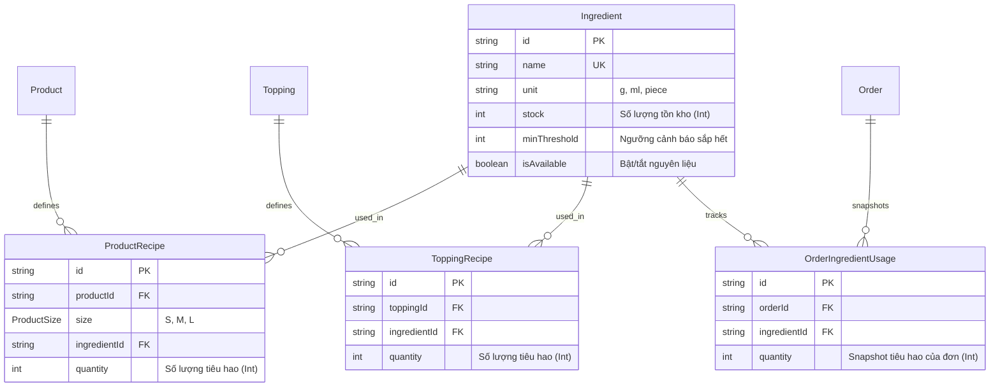

# TÀI LIỆU CHANGE REQUEST (CR-01): QUẢN LÝ TỒN KHO THEO NGUYÊN LIỆU

> **Mã CR:** CR-01  
> **Dự án:** BrewLite - Nền tảng Đặt Cà phê Trực tuyến  
> **Người lập:** Chiến (Leader / Architect)  
> **Ngày lập:** 27/10/2026  
> **Trạng thái:** ĐÃ PHÊ DUYỆT (GIAI ĐOẠN 1)  

---

## 1. BỐI CẢNH & MỤC TIÊU THAY ĐỔI

### 1.1. Yêu cầu mới từ Giảng viên hướng dẫn
- Các món trong thực đơn **phải được quản lý tồn kho dựa trên nguyên liệu (Ingredient-based Inventory / BOM - Bill of Materials)** thay vì trừ số lượng trực tiếp trên sản phẩm (`Product.stock`).
- Đặt món sẽ tiêu hao các nguyên liệu tương ứng với công thức pha chế của từng Size và Topping.
- Nếu bất kỳ nguyên liệu nào trong công thức không đủ số lượng tồn kho, đơn hàng không được phép tạo (trả về lỗi `400 Bad Request` kèm tên nguyên liệu bị thiếu).

### 1.2. Mục tiêu kỹ thuật Giai đoạn 1
1. **Chuẩn hóa F&B thực tế:** Không dùng đơn vị thô ("gói cà phê"), sử dụng đơn vị chuẩn: **gram (g)** cho bột/hạt/trà, **milliliter (ml)** cho chất lỏng/siro/sữa, và **cái/miếng (piece)** cho topping đóng hộp/lát hoa quả. Toàn bộ lưu dưới dạng **SỐ NGUYÊN (`Int`)** để loại trừ hoàn toàn sai số dấu phẩy động (`Float`).
2. **Hỗ trợ định lượng Size S/M/L & Topping:** Khi khách tăng size hoặc chọn topping, lượng tiêu hao nguyên liệu tăng theo đúng tỉ lệ pha chế (ví dụ: Size M tăng ~30–50% so với Size S; Size L tăng ~30–50% so với Size M).
3. **Cập nhật có điều kiện nguyên tử (D10):** Trừ kho nguyên liệu trực tiếp bằng truy vấn nguyên tử `stock >= qty` với `decrement: qty`. Gom nhu cầu theo `ingredientId` và sắp xếp tăng dần trước khi trừ để loại bỏ Deadlock giữa các transaction song song. Nguyên liệu **không dùng cột `version`** để tránh lỗi 400 giả mạo khi nhiều đơn hàng đặt đồng thời cùng loại nguyên liệu còn dồi dào.
4. **Snapshot hoàn kho (`OrderIngredientUsage`):** Khi đơn hàng bị hủy (`POST /orders/:id/cancel`), hệ thống hoàn kho dựa trên bảng snapshot `OrderIngredientUsage` đã lưu tại thời điểm tạo đơn, đảm bảo không phụ thuộc vào công thức sản phẩm tại thời điểm hủy.

---

## 2. QUY CHUẨN ĐỊNH LƯỢNG NGUYÊN LIỆU (F&B RECIPE STANDARD)

### 2.1. Đơn vị đo lường chuẩn (Base Units)
| Phân loại | Đơn vị lưu trữ | Kiểu dữ liệu | Ví dụ nguyên liệu |
| :--- | :---: | :---: | :--- |
| **Chất rắn / Bột** | `g` (gram) | `Int` | Hạt Cà phê Robusta/Arabica, Bột Matcha, Bột Cacao, Búp Trà Đen, Đường cát |
| **Chất lỏng** | `ml` (milliliter) | `Int` | Sữa tươi thanh trùng, Sữa đặc, Siro Đào, Nước cốt dừa, Kem béo |
| **Miếng / Cái / Lát** | `piece` (miếng/cái) | `Int` | Đào miếng ngâm, Thạch nha đam, Ly giấy/nhựa |

### 2.2. Bảng định lượng tiêu chuẩn mẫu (Seed Recipe Data)

#### A. Cà phê sữa truyền thống (Cà phê + Sữa đặc)
- **Size S (Tiêu chuẩn):** 18g hạt cà phê (1 shot espresso ~ 30ml) + 25ml sữa đặc.
- **Size M (Vừa, +38% cà phê, +40% sữa):** 25g hạt cà phê + 35ml sữa đặc.
- **Size L (Lớn, 2 shot espresso, ~+44% cà phê, ~+43% sữa so với M):** 36g hạt cà phê + 50ml sữa đặc.

#### B. Cà phê đen đá (Cà phê + Đường)
- **Size S:** 18g hạt cà phê + 15g đường cát.
- **Size M:** 25g hạt cà phê + 20g đường cát.
- **Size L:** 36g hạt cà phê + 30g đường cát.

#### C. Trà đào cam sả (Trà đen + Siro đào + Đào miếng)
- **Size S:** 10g búp trà đen + 20ml siro đào + 1 miếng đào ngâm.
- **Size M:** 15g búp trà đen + 30ml siro đào + 2 miếng đào ngâm.
- **Size L:** 20g búp trà đen + 45ml siro đào + 3 miếng đào ngâm.

#### D. Topping chọn thêm
- **Trân châu trắng:** 30g trân châu.
- **Kem Cheese:** 40ml kem cheese.
- **Đào miếng thêm:** 2 miếng đào ngâm.

---

## 3. CÁC QUYẾT ĐỊNH ĐÃ CHỐT (D10 – D16)

- **D10 (Cơ chế trừ kho nguyên liệu):** Trừ kho nguyên liệu bằng cập nhật có điều kiện nguyên tử:
  ```sql
  UPDATE ingredients SET stock = stock - :qty WHERE id = :id AND stock >= :qty
  ```
  Trong Prisma: `tx.ingredient.updateMany({ where: { id, stock: { gte: qty } }, data: { stock: { decrement: qty } } })`.
  Gom toàn bộ nhu cầu theo `ingredientId`, sau đó sắp xếp danh sách `ingredientId` theo thứ tự alphabet tăng dần trước khi trừ để chống Deadlock. Bảng `Ingredient` **KHÔNG có cột `version`** (Optimistic Lock theo version ở cấp nguyên liệu sẽ gây xung đột 400 giả khi nhiều đơn đặt đồng thời dù kho còn thừa hàng trăm phần).
- **D11 (Định mức nguyên liệu):** Đơn vị tính là `g`, `ml`, `piece`, lưu `Int` không dùng số thực. Mỗi bậc size tăng ~30–50% so với bậc dưới, làm tròn số nguyên.
- **D12 (Hiển thị Menu):** HOÃN SANG GIAI ĐOẠN 2. Giai đoạn 1 giữ nguyên `GET /products`, không lọc tồn kho nguyên liệu.
- **D13 (Bảo toàn Schema cũ):** GIỮ NGUYÊN các trường `Product.stock`, `Product.version`, `Topping.stock` trong `schema.prisma`. Đánh dấu chú thích `DEPRECATED` (không còn được dùng để trừ kho hay check overselling). Không xóa cột bằng migration ở giai đoạn này để tránh xung đột ngược; sẽ xóa dứt điểm ở Giai đoạn 2 bằng migration riêng.
- **D14 (Kiểm tra giỏ hàng khả dụng):** HOÃN SANG GIAI ĐOẠN 2. Frontend giữ nguyên, không validate nguyên liệu tại client giỏ hàng.
- **D15 (Quy tắc món/size chưa có công thức):** Khi tạo đơn hàng (`POST /orders`), nếu bất kỳ dòng món nào (`OrderItem`) không tìm thấy bản ghi `ProductRecipe` tương ứng với cặp `(productId, size)` thì API phải trả về HTTP `400 Bad Request`, `message`: `Món "<tên món>" (size <S|M|L>) chưa có công thức nguyên liệu.`
  Tuyệt đối không được coi là "tiêu hao 0" rồi cho phép đặt hàng (vì sẽ gây lỗi bán hàng vô hạn mà không tốn nguyên liệu). Việc kiểm tra này bắt buộc phải diễn ra **TRƯỚC** khi thực hiện trừ kho; nếu phát hiện thiếu công thức, toàn bộ transaction sẽ rollback lập tức: không tạo đơn hàng, không trừ bất kỳ nguyên liệu nào. Yêu cầu `seed.ts` (Lan phụ trách) phải cấu hình đầy đủ công thức nguyên liệu cho mọi (món, size) đang kinh doanh trên hệ thống.
- **D16 (Phân quyền người dùng - User Role):** Bổ sung thuộc tính `User.role` với enum `Role { CUSTOMER, ADMIN, BARISTA }` (mặc định `CUSTOMER`). Dùng chung trang đăng nhập hiện có. `role` được đưa vào JWT access token payload và `req.user = { sub, email, role }`. Client KHÔNG được gửi `role` khi đăng ký (`RegisterDto` không nhận trường role; `ValidationPipe` với `whitelist` và `forbidNonWhitelisted` sẽ chặn/loại bỏ). Kiểm soát phân quyền ở backend bằng decorator `@Roles(...)` kết hợp `RolesGuard` (chạy sau `JwtAuthGuard`, trả HTTP 403 Forbidden nếu không đủ quyền). Khi đăng nhập, frontend điều hướng theo role (`ADMIN` chuyển tới `/admin`, `CUSTOMER` ở trang khách). Tài khoản quản trị ADMIN được seed sẵn trong `seed.ts` (Lan phụ trách).
  > **Ghi chú tiến độ:** Code CR-ROLE đã hoàn thành trên nhánh CR-Chien, chờ Leader xác nhận.
- **Quy tắc Thanh toán thất bại & Hủy đơn:**
  - Thanh toán thất bại (`PAYMENT_FAILED`): **KHÔNG hoàn nguyên liệu** (khớp thiết kế D1: đơn vẫn ở trạng thái chờ thử lại thanh toán với cùng nguyên liệu đã giữ).
  - Hủy đơn (`POST /orders/:id/cancel` từ `PENDING` hoặc `PAYMENT_FAILED`): Hoàn nguyên liệu dựa trên snapshot bảng `OrderIngredientUsage`, không tính lại theo công thức hiện tại.
- **Xử lý lỗi thiếu hàng:** `POST /orders` trả HTTP `400 Bad Request`, `message` nêu rõ tên nguyên liệu thiếu (ví dụ: `Nguyên liệu "Hạt cà phê Robusta" không đủ số lượng tồn kho.`), giữ đúng chuẩn format lỗi hiện tại của `AllExceptionsFilter` để Frontend hiển thị toast thông báo bình thường.

---

## 4. THIẾT KẾ DATABASE (PRISMA SCHEMA DELTA)



### 4.1. Chi tiết Models Prisma mới
```prisma
model Ingredient {
  id           String   @id @default(cuid())
  name         String   @unique
  unit         String   // "g", "ml", "piece"
  stock        Int      @default(0)
  minThreshold Int      @default(50) @map("min_threshold")
  isAvailable  Boolean  @default(true) @map("is_available")
  createdAt    DateTime @default(now()) @map("created_at")
  updatedAt    DateTime @updatedAt @map("updated_at")

  productRecipes        ProductRecipe[]
  toppingRecipes        ToppingRecipe[]
  orderIngredientUsages OrderIngredientUsage[]

  @@map("ingredients")
}

model ProductRecipe {
  id           String      @id @default(cuid())
  productId    String      @map("product_id")
  size         ProductSize @default(M)
  ingredientId String      @map("ingredient_id")
  quantity     Int         // Số lượng tiêu hao (g, ml, piece)

  product      Product     @relation(fields: [productId], references: [id], onDelete: Cascade)
  ingredient   Ingredient  @relation(fields: [ingredientId], references: [id])

  @@unique([productId, size, ingredientId])
  @@map("product_recipes")
}

model ToppingRecipe {
  id           String     @id @default(cuid())
  toppingId    String     @map("topping_id")
  ingredientId String     @map("ingredient_id")
  quantity     Int        // Số lượng tiêu hao (g, ml, piece)

  topping      Topping    @relation(fields: [toppingId], references: [id], onDelete: Cascade)
  ingredient   Ingredient @relation(fields: [ingredientId], references: [id])

  @@unique([toppingId, ingredientId])
  @@map("topping_recipes")
}

model OrderIngredientUsage {
  id           String     @id @default(cuid())
  orderId      String     @map("order_id")
  ingredientId String     @map("ingredient_id")
  quantity     Int        // Snapshot tổng lượng tiêu hao của đơn

  order        Order      @relation(fields: [orderId], references: [id], onDelete: Cascade)
  ingredient   Ingredient @relation(fields: [ingredientId], references: [id])

  @@unique([orderId, ingredientId])
  @@map("order_ingredient_usages")
}
```

> [!NOTE]
> **Bảo toàn khả năng tương thích ngược:**
> - `Product.stock`, `Product.version`, `Topping.stock` vẫn giữ nguyên kiểu và giá trị mặc định trong `schema.prisma` nhưng được đánh dấu DEPRECATED.
> - Cột `User.role` (enum `Role`) và `RolesGuard` sẽ được bổ sung ngay trong Giai đoạn 1 bởi Chiến (task `CR-ROLE`) để thiết lập nền tảng phân quyền. Giao diện và API chi tiết cho Admin/Barista vẫn thuộc phạm vi Giai đoạn 2.

---

## 5. THUẬT TOÁN TRỪ KHO & HOÀN KHO

### 5.1. Thuật toán Trừ kho khi Tạo đơn (`POST /orders`)
```typescript
// Trong OrdersService.create, thực hiện bên trong tx ($transaction):

// =========================================================================
// BƯỚC 1: Nạp công thức nguyên liệu bằng truy vấn gộp (Batch query, chống N+1)
// =========================================================================
const allProductIds = Array.from(new Set(dto.items.map((i) => i.productId)));
const allToppingIds = Array.from(
  new Set(dto.items.flatMap((i) => i.toppingIds ?? [])),
);

// Truy vấn gộp thông tin sản phẩm (để lấy tên món khi ném lỗi D15)
const products = await tx.product.findMany({
  where: { id: { in: allProductIds } },
  select: { id: true, name: true },
});
const productNameMap = new Map(products.map((p) => [p.id, p.name]));

// Truy vấn gộp toàn bộ công thức món của các sản phẩm trong đơn
const rawProductRecipes = await tx.productRecipe.findMany({
  where: { productId: { in: allProductIds } },
});
// Nhóm công thức món theo key: `${productId}_${size}`
const productRecipeMap = new Map<string, Array<{ ingredientId: string; quantity: number }>>();
for (const r of rawProductRecipes) {
  const key = `${r.productId}_${r.size}`;
  const list = productRecipeMap.get(key) ?? [];
  list.push({ ingredientId: r.ingredientId, quantity: r.quantity });
  productRecipeMap.set(key, list);
}

// Truy vấn gộp toàn bộ công thức topping xuất hiện trong đơn
const rawToppingRecipes = allToppingIds.length > 0
  ? await tx.toppingRecipe.findMany({
      where: { toppingId: { in: allToppingIds } },
    })
  : [];
// Nhóm công thức topping theo toppingId
const toppingRecipeMap = new Map<string, Array<{ ingredientId: string; quantity: number }>>();
for (const tr of rawToppingRecipes) {
  const list = toppingRecipeMap.get(tr.toppingId) ?? [];
  list.push({ ingredientId: tr.ingredientId, quantity: tr.quantity });
  toppingRecipeMap.set(tr.toppingId, list);
}

// =========================================================================
// BƯỚC 2 (D15): Kiểm tra công thức từng dòng hàng & ghép danh sách lines
// =========================================================================
interface OrderLineRecipe {
  item: CreateOrderItemDto;
  productRecipes: Array<{ ingredientId: string; quantity: number }>;
  toppingRecipes: Array<{ ingredientId: string; quantity: number }>;
}

const lines: OrderLineRecipe[] = [];

for (const item of dto.items) {
  const itemSize = item.size ?? ProductSize.M;
  const recipeKey = `${item.productId}_${itemSize}`;
  const pRecipes = productRecipeMap.get(recipeKey) ?? [];

  // Quyết định D15: Nếu dòng hàng chưa có công thức -> 400 Bad Request
  if (pRecipes.length === 0) {
    const productName = productNameMap.get(item.productId) ?? item.productId;
    throw new BadRequestException(
      `Món "${productName}" (size ${itemSize}) chưa có công thức nguyên liệu.`,
    );
  }

  // Thu thập công thức của các topping thuộc dòng hàng này
  const tRecipes: Array<{ ingredientId: string; quantity: number }> = [];
  for (const toppingId of item.toppingIds ?? []) {
    const recipesForTopping = toppingRecipeMap.get(toppingId) ?? [];
    tRecipes.push(...recipesForTopping);
  }

  lines.push({
    item,
    productRecipes: pRecipes,
    toppingRecipes: tRecipes,
  });
}

// =========================================================================
// BƯỚC 3: Tạo danh sách nhu cầu nguyên liệu cần tiêu hao (needs: IngredientDemand[])
// =========================================================================
const needs: IngredientDemand[] = [];
for (const line of lines) {
  // 1. Tiêu hao theo công thức món: định mức (g, ml, piece) * số lượng món
  for (const pr of line.productRecipes) {
    needs.push({
      ingredientId: pr.ingredientId,
      quantity: pr.quantity * line.item.quantity,
    });
  }

  // 2. Tiêu hao theo công thức topping: lấy theo toppingId của từng dòng (không phụ thuộc size) * số lượng món
  for (const tr of line.toppingRecipes) {
    needs.push({
      ingredientId: tr.ingredientId,
      quantity: tr.quantity * line.item.quantity,
    });
  }
}
// Chú thích: Nếu nhiều dòng hàng hoặc nhiều topping dùng chung một nguyên liệu,
// helper deductIngredients sẽ tự động gom tổng số lượng và sắp xếp ingredientId tăng dần chống Deadlock.

// =========================================================================
// BƯỚC 4: Trừ kho nguyên tử bằng helper deductIngredients
// =========================================================================
// deductIngredients trả về danh sách IngredientUsage[] đã gom và trừ kho thành công
const deductedUsages = await deductIngredients(tx, needs);

// =========================================================================
// BƯỚC 5: Tạo Order và ghi Snapshot OrderIngredientUsage (không gom lần hai)
// =========================================================================
const order = await tx.order.create({
  data: {
    userId,
    totalAmount: finalAmount,
    status: OrderStatus.PENDING,
    items: {
      create: dto.items.map((item) => ({
        productId: item.productId,
        size: item.size ?? ProductSize.M,
        quantity: item.quantity,
        unitPrice: 0, // Tính từ PricingService
        subtotal: 0,  // Tính từ PricingService
        toppings: {
          create: (item.toppingIds ?? []).map((toppingId) => ({
            toppingId,
            price: 0,   // Tính từ PricingService
          })),
        },
      })),
    },
  },
});

// Ghi nhận Snapshot tiêu hao thực tế trực tiếp từ danh sách helper đã gom & trừ thành công
if (deductedUsages.length > 0) {
  await tx.orderIngredientUsage.createMany({
    data: deductedUsages.map((usage) => ({
      orderId: order.id,
      ingredientId: usage.ingredientId,
      quantity: usage.quantity,
    })),
  });
}
```

> [!NOTE]
> **CHỜ LEADER CHỐT:** Thiết kế hiện tại quản lý tiêu hao topping thông qua bảng quan hệ `ToppingRecipe` (mỗi topping gắn với 1 hoặc nhiều nguyên liệu). Nếu sau này Leader có quyết định thay đổi cách xử lý topping (ví dụ: dùng lại `Topping.stock` trực tiếp hoặc gắn topping trực tiếp vào `Ingredient`), thì hệ thống chỉ cần thay đổi phần nạp `toppingRecipes` ở **Bước 1** và **Bước 3**; toàn bộ các bước còn lại (kiểm tra D15, trừ kho nguyên tử `deductIngredients`, tạo `Order`, và lưu snapshot `OrderIngredientUsage`) giữ nguyên hoàn toàn. Không tự ý thay đổi thiết kế topping khi chưa có phê duyệt từ Leader.

### 5.2. Thuật toán Hoàn kho khi Hủy đơn (`POST /orders/:id/cancel`)
```typescript
// Trong CancelOrderService.cancel (do Vũ Huy phụ trách):
// 1. Chuyển trạng thái Order sang CANCELLED qua OrderService.transition()
await this.orderService.transition(tx, order.id, OrderStatus.CANCELLED, {
  changedBy: userId,
  reason: 'Customer cancelled',
});

// 2. Lấy snapshot từ OrderIngredientUsage
const usages = await tx.orderIngredientUsage.findMany({
  where: { orderId: order.id },
});

// 3. Tương thích ngược: Đơn cũ tạo trước migration không có snapshot thì không bị lỗi 500
// Hoàn trả nguyên liệu an toàn qua helper restoreIngredients
if (usages.length > 0) {
  await restoreIngredients(
    tx,
    usages.map((u) => ({
      ingredientId: u.ingredientId,
      quantity: u.quantity,
    })),
  );
}
```

---

## 6. PHÂN CÔNG CÔNG VIỆC GIAI ĐOẠN 1 (6 THÀNH VIÊN)

| Người phụ trách | Vai trò | Nhiệm vụ cụ thể | Tiêu chí hoàn thành (Done Definition) |
| :--- | :--- | :--- | :--- |
| **Chiến** | Leader / Architect | - **CR-DESIGN:** Toàn bộ thiết kế kiến trúc CR-01, cơ chế trừ/hoàn kho nguyên liệu (D10–D15), đặc tả User Role & RolesGuard (D16), cập nhật docs/auth/**, diagrams ERD/UML, Prisma schema nền tảng, helper deductIngredients/restoreIngredients.<br>- **CR-ROLE:** Hiện thực role: enum `Role` + cột `User.role` (migration `add_user_role`); đưa role vào JWT payload và `req.user`; viết decorator `@Roles()` + `RolesGuard`; `RegisterDto` không nhận role; frontend lưu role trong `useAuthStore`, đăng nhập ADMIN chuyển tới `/admin`, `useRequireAuth` nhận tham số role; unit test `RolesGuard`.<br>- **CR-VERIFY:** Tích hợp code các nhánh, chạy toàn bộ test suites và cập nhật tài liệu/README sau cùng. | Migration chạy sạch; build/test pass; helper trả về đúng danh sách gom; docs và Excel đồng bộ 100%. |
| **Lan** | Seed & Data | - Viết tài liệu `docs/seed-recipes.md` thống kê định mức F&B thực tế.<br>- Sửa `seed.ts`: Seed danh mục `Ingredient`, `ProductRecipe` cho MỌI (món, size), `ToppingRecipe` cho các topping, 1 nguyên liệu có tồn kho thấp để test.<br>- **CR-LAN-ADMIN:** Seed tài khoản `ADMIN` trong `seed.ts` (làm sau khi CR-ROLE merge): upsert theo email, role ADMIN, mật khẩu băm bcrypt cùng số rounds với auth.service; `ADMIN_EMAIL`/`ADMIN_PASSWORD` đọc từ env, fallback dev mặc định; thêm biến mẫu vào `.env.example`; ghi tài khoản demo vào `docs/seed-recipes.md` hoặc README.<br>- Giữ `Product.stock > 0` vì `GET /products` vẫn đọc cột deprecated này trong Giai đoạn 1.<br>- **Làm sau khi CR-ROLE merge** để cung cấp dữ liệu chuẩn cho các nhánh khác. | `prisma db seed` chạy 2 lần liên tiếp không lỗi; DB có đủ nguyên liệu & công thức cho mọi món/size; Product.stock > 0; đăng nhập được bằng tài khoản ADMIN. |
| **Hạnh** | Order Core | - Sửa `OrdersService.create`: Kiểm tra thiếu công thức theo quy tắc D15; trừ kho theo nguyên liệu qua helper `deductIngredients`; ghi `OrderIngredientUsage` từ danh sách helper trả về.<br>- Viết lại unit test `orders.service.spec.ts` (và `order.service.spec.ts` nếu còn mock stock cũ).<br>- Cập nhật tài liệu `docs/order/**` (kể cả phần hủy đơn) và file `requests/orders.http`. | Test orders pass; đơn thiếu nguyên liệu trả lỗi 400 rõ tên; món/size chưa có công thức trả 400 rõ ràng; snapshot được lưu đầy đủ. |
| **Vũ Huy** | Cancel Order | - Sửa `CancelOrderService.cancel`: Hoàn nguyên liệu bằng `restoreIngredients` theo snapshot `OrderIngredientUsage` trong cùng transaction với `OrderService.transition()`.<br>- Đơn cũ tạo trước migration không có snapshot thì bỏ qua (tương thích ngược).<br>- Giữ nguyên các rules hiện có: 404 khác chủ, 409 sai trạng thái / hủy 2 lần, không hoàn lần 2.<br>- Cập nhật file `requests/cancel-order.http`. | Hủy đơn hoàn đúng tồn kho theo snapshot; không lỗi với đơn cũ không có snapshot; các ca lỗi 404/409 giữ nguyên hành vi. |
| **Kiệt** | Payment Core | - Rà soát module payments: Đảm bảo thanh toán thất bại (`PAYMENT_FAILED`), thử lại (retry), replay không làm thay đổi hay hoàn nhầm tồn kho nguyên liệu.<br>- Cập nhật tài liệu `docs/payment/**`.<br>- Chạy lại test Task 10(b) (idempotency thanh toán) và file `requests/payment.http`. | Test Task 10(b) pass; thanh toán lỗi/retry không làm sai lệch tồn kho nguyên liệu. |
| **Hào** | Concurrency Test | - Viết lại script test đồng thời `backend/test/concurrency.ts` và e2e test `orders-concurrency.e2e-spec.ts` (tiêu chí Task 10(c)/(c2)) theo tồn kho nguyên liệu.<br>- Cập nhật kịch bản test `TS-FR-09-01` trong `docs/test-scenarios`. | Test đồng thời Task 10(c) pass: 10 request đồng thời trừ kho chính xác, không overselling nguyên liệu, không deadlock. |

> **Ghi chú về phân công:** Thành viên **Quang Huy** không thuộc phạm vi thực hiện của Change Request CR-01 (không phân công task trong đợt này).

### Thứ tự Merge nhánh:
$$\text{Chiến (CR-DESIGN, CR-ROLE)} \longrightarrow \text{Lan (Seed + Admin)} \longrightarrow \text{Hạnh (Order)} \longrightarrow \text{Vũ Huy (Cancel)} \longrightarrow \text{Kiệt (Payment)} \longrightarrow \text{Hào (Test Task 10c)} \longrightarrow \text{Chiến (CR-VERIFY)}$$

---

## 7. GIAI ĐOẠN 2 (KẾ HOẠCH BỔ SUNG SAU)
Các tính năng sau sẽ được chuyển sang Giai đoạn 2 và thực hiện bằng Change Request riêng:
1. **Admin Quản lý Kho:** Màn hình `/admin/ingredients`, API `GET /admin/ingredients`, `PATCH /admin/ingredients/:id/stock`.
2. **Barista KDS:** Màn hình `/barista`, API `GET /barista/orders`, `PATCH /barista/orders/:id/status`.
3. **Giao diện & Chức năng Admin/Barista nâng cao:** Màn hình quản lý người dùng, phân quyền động (nền tảng User.role và RolesGuard đã hoàn thành ở Giai đoạn 1).
4. **AvailabilityService:** Tính toán cờ `isAvailable` động cho Menu và Product Detail dựa trên tồn kho nguyên liệu.
5. **Giao diện Giỏ hàng & Thực đơn:** Cảnh báo món hết nguyên liệu trên UI trước khi bấm Đặt hàng.
6. **Dọn dẹp Database:** Migration xóa các cột cũ `Product.stock`, `Product.version`, `Topping.stock`.
7. **Báo cáo LaTeX:** Cập nhật chi tiết đồ án trong `main.tex`.

---

## 8. HẠN CHẾ ĐÃ BIẾT (KNOWN LIMITATIONS - GIAI ĐOẠN 1)
- **Menu vẫn hiển thị món hết nguyên liệu:** Vì D12 và D14 hoãn sang Giai đoạn 2, các món hết nguyên liệu vẫn xuất hiện trên Menu và trang Chi tiết. Khách hàng chỉ nhận biết khi bấm "Đặt hàng" tại màn Checkout và nhận được thông báo lỗi HTTP 400 nêu rõ nguyên liệu nào đã hết.
- **Yêu cầu dữ liệu Seed đầy đủ công thức:** Mọi sản phẩm và bậc size (S/M/L) đang bán bắt buộc phải có đầy đủ định mức trong bảng `ProductRecipe` (do Lan seed). Nếu một món thiếu công thức, hệ thống sẽ chặn tạo đơn theo D15 thay vì cho phép đặt với lượng tiêu hao bằng 0.
