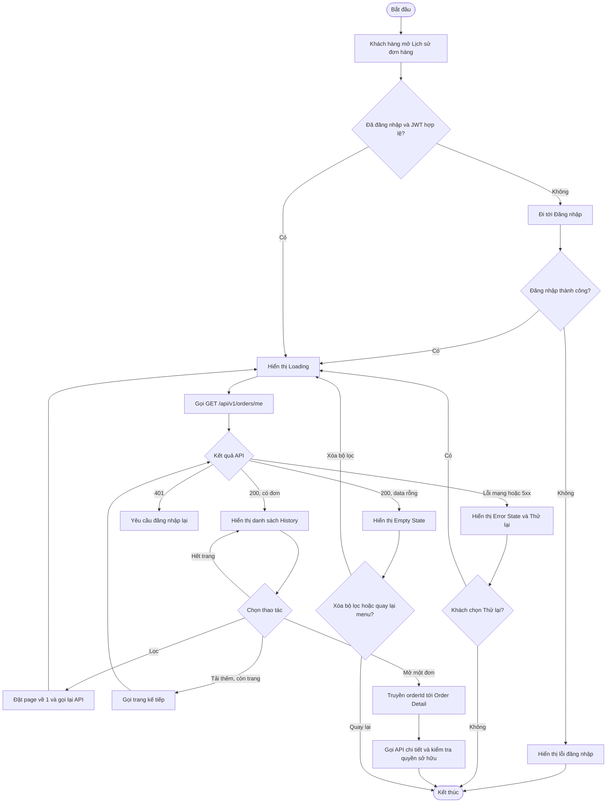

# ĐẶC TẢ USE CASE PHÂN HỆ LỊCH SỬ ĐƠN HÀNG (ORDER HISTORY SPECIFICATION)
### Tác giả: Nguyễn Quang Huy (Owner Feature: Order History)
**Dự án:** BrewLite – Hệ Thống Đặt Cà Phê Không Dùng Tiền Mặt  
**Feature:** 7  
**Phạm vi:** Thiết kế Order History và bộ kịch bản kiểm thử End-to-End; đặc tả Use Case, Activity, Wireframe/UI states, draft API và kế hoạch Integration Test.

---

## 1. TỔNG QUAN PHÂN HỆ (MODULE OVERVIEW)

Phân hệ Lịch sử đơn hàng cho phép khách hàng đã đăng nhập xem lại các đơn hàng
được tạo từ tài khoản BrewLite của mình. Khách hàng có thể theo dõi mã đơn,
thời điểm đặt, tổng tiền và trạng thái hiện tại; lọc danh sách theo trạng thái,
duyệt các trang/kết quả tiếp theo và mở một đơn để xem chi tiết.

Backend phải giới hạn dữ liệu theo người dùng được xác thực: khách hàng chỉ xem
đơn thuộc tài khoản của mình. Dữ liệu đơn hàng được lấy từ endpoint
`GET /orders/me`; nguồn yêu cầu BrewLite hiện nêu endpoint và các thực thể Order,
OrderItem, nhưng chưa quy định chi tiết phân trang, schema response hay endpoint
chi tiết đơn. Các quy ước bổ sung trong tài liệu này được ghi là **đề xuất** để
Frontend, Backend và QA có cùng hợp đồng triển khai.

* **Ca sử dụng cốt lõi:** `UC-ORDER-HISTORY` – Xem lịch sử đơn hàng.

### Đầu ra và tiêu chí nghiệm thu theo Task 7

| Hạng mục | Nội dung / tiêu chí hoàn thành |
|---|---|
| Use Case + Specification | UC History có Actor, mục đích, pre/post-condition, happy path, luồng thay thế/lỗi và quy tắc nghiệp vụ. |
| Activity | Có sơ đồ thể hiện luồng xem danh sách, nhánh có/không có đơn, tải thêm, mở chi tiết và xử lý lỗi chính. |
| Wireframe / Figma | Có bố cục History và mô tả đủ Loading, Empty, Error, Success/Data; nội dung trong file này là wireframe đặc tả, chưa phải link/tệp Figma đã publish. |
| Test scenario matrix | Bao phủ E2E và Integration cho happy path, không có dữ liệu, xác thực, phân trang, lỗi mạng/server và phân quyền. |
| API contract | Có draft `GET /orders/me` đầy đủ query, header, response và error message theo chuẩn BrewLite; mapping Order Detail được mô tả. |
| Acceptance criteria | Happy path hoạt động; lỗi chính có kết quả xác định; chọn đơn History ánh xạ đúng Order; từng test case có Expected Result kiểm chứng được. |

### Phạm vi và quy ước

| Nội dung | Quy ước |
|---|---|
| Feature / Owner | Feature 7 – Nguyễn Quang Huy |
| Mục tiêu task | Thiết kế Order History và bộ kịch bản test để kiểm tra end-to-end |
| Phạm vi task | UC History; Activity xem lịch sử; test scenarios cho happy path và lỗi |
| Đối tượng dữ liệu | Các đơn có `userId` khớp với người dùng trong JWT hợp lệ |
| Thứ tự mặc định | `createdAt` giảm dần (đơn mới nhất trước); dùng thêm `id` làm khóa sắp xếp phụ ổn định |
| Trạng thái đơn | `PENDING`, `PAID`, `PREPARING`, `READY`, `COMPLETED`, `PAYMENT_FAILED`, `CANCELLED` |
| Phân trang đề xuất | Page bắt đầu từ 1; `limit` mặc định 20, tối đa 50 |
| Chi tiết đơn | Điều hướng bằng `orderId`; màn hình chi tiết tải dữ liệu đầy đủ từ Backend và không tin snapshot từ Client là dữ liệu chuẩn |
| Đầu ra | Use Case + Specification; Activity; Figma/Wireframe; test scenario matrix; API contract và Integration Test Plan |
| Wireframe | Tài liệu này đặc tả bố cục và states để dựng Figma; chưa có link/tệp Figma đính kèm |

## 2. BẢNG ĐẶC TẢ CHI TIẾT (USE CASE SPECIFICATIONS)

### UC-ORDER-HISTORY: XEM LỊCH SỬ ĐƠN HÀNG (ORDER HISTORY)

| Thuộc tính | Chi tiết đặc tả |
| :--- | :--- |
| **Mã Use Case** | `UC-ORDER-HISTORY` |
| **Tên Use Case** | Xem lịch sử đơn hàng |
| **Actor chính** | Khách hàng đã đăng nhập (Customer) |
| **Mục đích** | Xem, lọc, phân trang lịch sử đơn hàng thuộc tài khoản của khách hàng và mở chi tiết một đơn. |
| **Điều kiện tiên quyết (Pre-condition)** | Khách hàng đã đăng nhập và có JWT hợp lệ; API BrewLite có thể truy cập được. |
| **Điều kiện kết thúc (Post-condition)** | Danh sách đơn thuộc khách hàng được hiển thị, hoặc Empty State nếu không có kết quả; dữ liệu đơn không bị thay đổi. Khi mở chi tiết, màn hình Order Detail tải đơn theo `orderId` và Backend xác thực quyền sở hữu. |

#### Luồng sự kiện chính (Main Flow - Happy Path):

1. Khách hàng mở mục **Lịch sử đơn hàng** trong ứng dụng BrewLite.
2. Frontend xác nhận phiên đăng nhập; hiển thị Loading State.
3. Frontend gửi `GET /api/v1/orders/me?page=1&limit=20` kèm JWT trong header `Authorization: Bearer <JWT>`. Nếu có bộ lọc, gửi thêm `status`.
4. NestJS `JwtAuthGuard` xác thực token; Backend lấy `userId` từ request đã xác thực, không nhận định danh chủ đơn từ Client.
5. Backend validate query parameters, truy vấn đơn của user hiện tại, áp dụng bộ lọc nếu có, sắp xếp đơn mới nhất trước và phân trang.
6. Backend trả `200 OK` với danh sách tóm tắt cùng metadata phân trang. Nếu không có đơn phù hợp, trả danh sách rỗng.
7. Frontend ẩn Loading State và hiển thị Success/Data State hoặc Empty State.
8. Khách hàng xem mã đơn, thời điểm, trạng thái, tổng tiền; có thể đổi bộ lọc hoặc tải trang tiếp theo.
9. Khách hàng chọn một đơn hàng. Frontend điều hướng tới route chi tiết như `/orders/{orderId}`, dùng `id` của đơn làm định danh.
10. Màn hình Order Detail tải dữ liệu đơn và OrderItem mới nhất từ Backend; Backend xác thực đơn thuộc user hiện tại trước khi trả dữ liệu.

#### Các luồng thay thế & ngoại lệ (Alternative & Exception Flows):

* **A1: Lọc theo trạng thái:** Khi khách hàng chọn trạng thái, Frontend đặt lại `page=1` và gửi `status` hợp lệ. Khi bỏ lọc, gửi request không có `status`.
* **A2: Tải thêm / chuyển trang:** Frontend tăng `page` sau khi request trước hoàn tất thành công, giữ nguyên `limit` và `status`. Khi hết dữ liệu, dừng tải thêm.
* **A3: Không có đơn phù hợp:** API trả `200 OK` với `data: []`; Frontend hiển thị Empty State. Nếu đang lọc, cho phép khách hàng xóa bộ lọc.
* **E1: Chưa đăng nhập:** Frontend không gọi API; chuyển tới màn hình đăng nhập hoặc yêu cầu đăng nhập. Sau đăng nhập, quay lại History nếu ứng dụng hỗ trợ.
* **E2: Token hết hạn / không hợp lệ (`401 Unauthorized`):** Backend trả error envelope chuẩn. Chỉ refresh token nếu hệ thống đã hỗ trợ. Nếu không có hoặc refresh thất bại, kết thúc phiên phù hợp và yêu cầu đăng nhập lại; không lặp request vô hạn.
* **E3: Lỗi mạng / timeout:** Frontend hiển thị Error State và nút **Thử lại**; không coi lỗi mạng là danh sách rỗng. Thử lại request với cùng trang và bộ lọc.
* **E4: Lỗi Backend (`5xx`):** Hiển thị thông báo không thể tải lịch sử và cho phép thử lại; không xóa cache hợp lệ hoặc giả lập thành công.
* **E5: Query không hợp lệ (`400 Bad Request`):** API trả error envelope chuẩn; với lỗi `ValidationPipe`, `message` là mảng mô tả các trường vi phạm. Client không lặp lại request sai.
* **E6: Trang lớn hơn tổng số trang:** API trả `200 OK` với `data: []` và metadata hiện tại; UI dừng tải thêm.
* **E7: Đơn không tồn tại hoặc không thuộc user:** Endpoint chi tiết (nếu được triển khai) trả `404 Not Found` cho cả hai trường hợp để không tiết lộ đơn của người khác.

#### Activity xem lịch sử đơn hàng



#### History mapping tới Order Detail

**Dữ liệu tối thiểu trên mỗi mục History** được đề xuất gồm:

| Trường | Kiểu | Mục đích |
|---|---|---|
| `id` | string | Định danh Order ổn định; dùng làm `orderId` khi điều hướng/tải chi tiết |
| `orderCode` | string | Mã dễ đọc hiển thị cho khách hàng; có thể trùng `id` nếu hệ thống chưa có mã riêng |
| `status` | enum string | Trạng thái mới nhất của đơn |
| `createdAt` | ISO-8601 string | Thời điểm tạo đơn, có timezone |
| `total` | number | Tổng tiền của đơn |
| `currency` | string | Mã tiền tệ, ví dụ `VND` |
| `itemCount` | integer | Tổng số lượng sản phẩm trong đơn, nếu API hỗ trợ |

Khi khách hàng chọn một mục:

1. Frontend dùng **`id`** làm định danh chuẩn, ví dụ route `/orders/{id}`. Không dùng vị trí phần tử trong mảng hoặc `orderCode` làm khóa tra cứu nếu chúng không được định nghĩa là ID.
2. Có thể truyền snapshot `orderCode`, `status`, `createdAt`, `total`, `currency`, `itemCount` để hiển thị placeholder tức thì; snapshot không thay thế dữ liệu Backend.
3. Màn hình chi tiết tải dữ liệu đầy đủ, tối thiểu gồm thông tin Order và các OrderItem (`productId`, tên sản phẩm nếu có, `size`, `qty`, `lineTotal`). Thông tin thanh toán chỉ hiển thị nếu API chi tiết cho phép.
4. Backend lấy user từ JWT và kiểm tra `Order.userId`; Client không được quyết định quyền sở hữu bằng dữ liệu điều hướng.
5. Nguồn yêu cầu hiện chỉ liệt kê `GET /orders/me`, chưa xác nhận endpoint chi tiết. **Đề xuất bổ sung** `GET /api/v1/orders/:id` để tải chi tiết; cần thống nhất endpoint này với nhóm Backend trước khi triển khai.

## 3. QUY TẮC NGHIỆP VỤ & BẢO MẬT (BUSINESS RULES)

1. **BR-ORDER-HISTORY-01 (Phạm vi dữ liệu):** Chỉ trả các Order có `userId` khớp với user lấy từ JWT đã được xác thực. Không dùng `userId` do Client truyền lên để xác định quyền sở hữu.
2. **BR-ORDER-HISTORY-02 (JWT bắt buộc):** Endpoint lịch sử yêu cầu `JwtAuthGuard`; thiếu token, token hết hạn hoặc chữ ký không hợp lệ phải trả `401 Unauthorized`.
3. **BR-ORDER-HISTORY-03 (Thứ tự ổn định):** Mặc định sắp xếp `createdAt DESC`, dùng `id` (hoặc khóa ổn định tương đương) làm tiêu chí phụ.
4. **BR-ORDER-HISTORY-04 (Phân trang):** `page` bắt đầu từ 1; `limit` mặc định 20 và tối đa 50 theo quy ước đề xuất. Query không hợp lệ trả `400 Bad Request`; page hợp lệ vượt tổng số trang trả danh sách rỗng.
5. **BR-ORDER-HISTORY-05 (Trạng thái):** Bộ lọc chỉ chấp nhận trạng thái đơn BrewLite: `PENDING`, `PAID`, `PREPARING`, `READY`, `COMPLETED`, `PAYMENT_FAILED`, `CANCELLED`. History chỉ đọc trạng thái hiện tại, không tự chuyển trạng thái.
6. **BR-ORDER-HISTORY-06 (Bảo vệ dữ liệu):** Chỉ trả dữ liệu cần cho màn hình lịch sử; không trả `passwordHash`, token, `idempotencyKey` hoặc thông tin nhạy cảm không liên quan.
7. **BR-ORDER-HISTORY-07 (Truy cập chi tiết):** Màn hình chi tiết phải tải dữ liệu chuẩn từ Backend. Endpoint chi tiết cần kiểm tra quyền sở hữu ở Server; snapshot do Client truyền chỉ dùng hiển thị tạm thời.
8. **BR-ORDER-HISTORY-08 (Không thay đổi đơn):** Truy vấn lịch sử không được cập nhật Order, OrderItem, Payment hoặc trạng thái đơn.

---

## 4. HỢP ĐỒNG API (API CONTRACT & SAMPLES)

### 4.1 Danh mục API trong luồng

| Method | Endpoint | Vai trò trong luồng | Trạng thái |
|---|---|---|---|
| `POST` | `/api/v1/auth/login` | Đăng nhập để nhận JWT khi người dùng chưa có phiên hợp lệ. | API phụ thuộc đã được đặc tả ở tài liệu Auth; không thuộc phần triển khai mới của Task 7. |
| `GET` | `/api/v1/orders/me` | Lấy lịch sử đơn theo user hiện tại; API chính của Use Case. | Draft bắt buộc trong phạm vi Task 7. |
| `GET` | `/api/v1/orders/:id` | Lấy chi tiết Order sau khi người dùng chọn một mục History. | Đề xuất bổ sung; cần Backend xác nhận vì nguồn hiện chỉ nêu `GET /orders/me`. |

### 4.2 Lịch sử đơn hàng: `GET /api/v1/orders/me`

* **Request Header:**
  * `Authorization: Bearer <JWT>` (**bắt buộc**); JWT access token do API đăng nhập BrewLite cấp.
  * `Accept: application/json` (khuyến nghị).
* **Query Parameters:**

| Tham số | Kiểu | Bắt buộc | Mặc định / giới hạn | Mô tả |
| :--- | :--- | :---: | :--- | :--- |
| `page` | integer | Không | `1`, tối thiểu `1` | Trang cần lấy, đánh số từ 1. |
| `limit` | integer | Không | `20`, tối thiểu `1`, tối đa `50` | Số đơn tối đa trên một trang. |
| `status` | string enum | Không | Không lọc | Lọc theo `PENDING`, `PAID`, `PREPARING`, `READY`, `COMPLETED`, `PAYMENT_FAILED`, `CANCELLED`. |

`Authorization` là tên header xác thực; hệ thống không quy định API key dạng secret riêng cho endpoint này. Không đưa JWT/API secret vào query string hoặc log.

**Các key quy ước của response:**

| Key | Vị trí | Ý nghĩa / quy tắc |
| :--- | :--- | :--- |
| `success` | Top-level | `true` nếu request thành công; `false` nếu có lỗi. |
| `statusCode` | Top-level | HTTP status code của response, ví dụ `200`, `400`, `401`, `500`. |
| `data` | Top-level | Với API danh sách, luôn là mảng các đơn; rỗng khi không có kết quả. |
| `pagination` | Top-level, đề xuất mở rộng | Metadata phân trang (`page`, `limit`, `totalItems`, `totalPages`, `hasNextPage`); bổ sung ngoài envelope cơ bản để không biến `data` thành object. |
| `timestamp` | Top-level | Thời điểm tạo response theo ISO-8601. |
| `error` | Top-level, chỉ response lỗi | Tên lỗi tổng quát, ví dụ `Bad Request`, `Unauthorized`, `Internal Server Error`. |
| `message` | Top-level, chỉ response lỗi | Nội dung lỗi; có thể là chuỗi hoặc mảng message validation. |
| `path` | Top-level, chỉ response lỗi | Đường dẫn request gây lỗi. |
| `Authorization` | HTTP Request Header | Header xác thực theo dạng Bearer JWT; không phải API key secret riêng. |
| `page`, `limit`, `status` | Query string | Các key request tùy chọn để phân trang và lọc trạng thái. |

* **Request mẫu:**
  ```http
  GET /api/v1/orders/me?page=1&limit=20
  Authorization: Bearer <JWT>
  Accept: application/json
  ```
* **Response thành công (`200 OK`):**
  ```json
  {
    "success": true,
    "statusCode": 200,
    "data": {
      "items": [
        {
          "id": "cmv5t0qeq0000mq6wzi4wzbl2",
          "orderNumber": 1042,
          "status": "PREPARING",
          "totalAmount": 125000,
          "discountAmount": 0,
          "finalAmount": 125000,
          "createdAt": "2026-10-09T08:30:00.000Z",
          "itemCount": 2
        },
        {
          "id": "cmv5t0qeq0000mq6wzi4wzbl1",
          "orderNumber": 1041,
          "status": "COMPLETED",
          "totalAmount": 89000,
          "discountAmount": 0,
          "finalAmount": 89000,
          "createdAt": "2026-10-08T12:15:00.000Z",
          "itemCount": 1
        }
      ],
      "pagination": {
        "page": 1,
        "limit": 20,
        "total": 2,
        "totalPages": 1,
        "hasNextPage": false
      }
    },
    "timestamp": "2026-10-09T08:35:00.000Z"
  }
  ```
  Các key bắt buộc theo `TransformInterceptor` là `success`, `statusCode`, `data`, `timestamp`. Dữ liệu controller trả về được bọc trong `data` gồm mảng `items` và metadata `pagination`. Khi không có đơn phù hợp, `items` là `[]`, `pagination.total`/`pagination.totalPages` là `0`, `pagination.hasNextPage` là `false`.
* **Response lỗi:**

| HTTP Status | `error` | `message` quy ước | Xử lý |
| :--- | :--- | :--- | :--- |
| `400 Bad Request` | `Bad Request` | Nội dung validation; `ValidationPipe` có thể trả mảng message, ví dụ `["page must not be less than 1"]` | Client hiển thị lỗi phù hợp và không retry query sai. |
| `401 Unauthorized` | `Unauthorized` | `Vui lòng đăng nhập để tiếp tục` | Client yêu cầu đăng nhập lại; không trả dữ liệu đơn. |
| `403 Forbidden` | `Forbidden` | `Bạn không có quyền thực hiện thao tác này` | Không tiết lộ dữ liệu; áp dụng cho trường hợp bị từ chối theo policy. |
| `404 Not Found` | `Not Found` | `Không tìm thấy đơn hàng` | Dùng cho đơn chi tiết không tồn tại/không thuộc user, nếu endpoint chi tiết được triển khai. |
| `500 Internal Server Error` | `Internal Server Error` | `Internal server error` | Trả thông báo tổng quát; không để lộ stack trace. |

Mọi response lỗi dùng các key chuẩn `success`, `statusCode`, `error`, `message`, `timestamp`, `path`. Ví dụ `401 Unauthorized`:
  ```json
  {
    "success": false,
    "statusCode": 401,
    "error": "Unauthorized",
    "message": "Vui lòng đăng nhập để tiếp tục",
    "timestamp": "2026-10-09T08:35:00.000Z",
    "path": "/api/v1/orders/me"
  }
  ```
  Ví dụ lỗi validation (`400 Bad Request`):
  ```json
  {
    "success": false,
    "statusCode": 400,
    "error": "Bad Request",
    "message": [
      "page must not be less than 1",
      "status must be a valid enum value"
    ],
    "timestamp": "2026-10-09T08:35:00.000Z",
    "path": "/api/v1/orders/me?page=0&status=UNKNOWN"
  }
  ```
  Ví dụ lỗi server (`500 Internal Server Error`):
  ```json
  {
    "success": false,
    "statusCode": 500,
    "error": "Internal Server Error",
    "message": "Internal server error",
    "timestamp": "2026-10-09T08:35:00.000Z",
    "path": "/api/v1/orders/me"
  }
  ```

* **Lưu ý hợp đồng:** Tài liệu nguồn BrewLite xác nhận endpoint logic `GET /orders/me` nhưng chưa chốt prefix, phân trang hoặc schema item. Trong tài liệu này, base path `/api/v1` được áp dụng để nhất quán với API Auth (`GET /api/v1/orders/me`). Metadata `pagination` top-level là quy ước mở rộng đề xuất; envelope và các key/message lỗi tuân theo checklist `TransformInterceptor`/`AllExceptionsFilter`.

### 4.3 Chi tiết đơn hàng (đề xuất): `GET /api/v1/orders/:id`

Endpoint này hỗ trợ mapping từ một item History tới dữ liệu Order Detail. Đây là API đề xuất, cần xác nhận với Backend vì tài liệu nguồn chỉ liệt kê `GET /orders/me`.

* **Request Header:** `Authorization` Bearer JWT (bắt buộc); `Accept: application/json` (khuyến nghị).
* **Path Parameter:**

| Tham số | Kiểu | Bắt buộc | Mô tả |
| :--- | :--- | :---: | :--- |
| `id` | string | Có | ID Order lấy từ `data[n].id` của response History. |

* **Quy tắc truy cập:** Backend lấy user từ JWT, truy vấn Order theo `id` và `userId` cùng lúc. Không nhận `userId` từ Client. Nếu không tìm thấy hoặc Order thuộc user khác, trả `404 Not Found`.
* **Response thành công (`200 OK`):**
  ```json
  {
    "success": true,
    "statusCode": 200,
    "data": {
      "id": "cmv5t0qeq0000mq6wzi4wzbl2",
      "orderNumber": 1042,
      "status": "PREPARING",
      "totalAmount": 125000,
      "discountAmount": 0,
      "finalAmount": 125000,
      "createdAt": "2026-10-09T08:30:00.000Z",
      "items": [
        {
          "id": "item_01J8K4QZ",
          "productId": "cmv5p023c0007mq44py7r5lut",
          "name": "Cà phê sữa đá",
          "size": "M",
          "quantity": 2,
          "unitPrice": 40000,
          "lineTotal": 125000,
          "toppings": [
            {
              "id": "oit_01J8K4QZ",
              "toppingId": "cmv5p02340003mq449hok5wj6",
              "name": "Trân châu đen",
              "price": 10000
            }
          ]
        }
      ]
    },
    "timestamp": "2026-10-09T08:36:00.000Z"
  }
  ```
  Với response chi tiết, `data` là object đơn hàng theo envelope thành công BrewLite. Không trả thông tin bí mật thanh toán hoặc dữ liệu không cần cho Order Detail.
* **Response lỗi:** Dùng error envelope chung tại mục 4.1. Ngoài `401`/`500`, `404` dùng `error: "Not Found"` và message thống nhất “Không tìm thấy đơn hàng” cho ID không tồn tại và ID không thuộc user.

---

## 5. ĐẶC TẢ GIAO DIỆN (WIREFRAME & UI STATES)

### 5.1 Bố cục màn hình đề xuất

1. Tiêu đề trang **Lịch sử đơn hàng**.
2. Bộ lọc trạng thái: **Tất cả**, **Chờ thanh toán**, **Đã thanh toán**, **Đang pha chế**, **Sẵn sàng**, **Hoàn tất**, **Thanh toán thất bại**, **Đã hủy**. Hiển thị nhãn thân thiện; gửi enum trạng thái tương ứng lên API.
3. Danh sách card đơn hàng. Mỗi card hiển thị mã đơn, thời gian, trạng thái, số lượng món (nếu có), tổng tiền và affordance mở chi tiết.
4. Khu vực tải thêm/phân trang; chỉ hiển thị khi còn trang tiếp theo. Trên giao diện nhỏ có thể dùng nút **Xem thêm** hoặc infinite scroll.
5. Các trạng thái Loading, Empty và Error thay thế vùng nội dung danh sách; bộ lọc và tiêu đề không cần biến mất khi phù hợp.

#### Wireframe mức đặc tả (đầu vào để dựng Figma)

```text
+----------------------------------------------------------+
| BrewLite                                  Tài khoản  [v] |
+----------------------------------------------------------+
| Lịch sử đơn hàng                                        |
| [Tất cả] [Chờ thanh toán] [Đã thanh toán] [Hoàn tất]    |
|                                                          |
| +------------------------------------------------------+ |
| | BL-2026-00125                  [Đang pha chế]         | |
| | 09/10/2026 08:30 · 2 món                             | |
| | Tổng cộng                                      125.000đ | |
| |                                      [Xem chi tiết >] | |
| +------------------------------------------------------+ |
|                                                          |
|                 [Xem thêm đơn hàng]                     |
+----------------------------------------------------------+
```

#### Các frame cần thiết trong Figma

| Frame | Nội dung cần vẽ | Hành vi chính |
|---|---|---|
| History / Loading | Header, bộ lọc, 2-3 skeleton card | Giữ layout ổn định trong khi tải trang đầu |
| History / Empty | Icon minh họa, nội dung “Bạn chưa có đơn hàng”, CTA quay lại menu | Chỉ hiển thị sau response thành công với danh sách rỗng |
| History / Error | Icon/thông báo không tải được, nút **Thử lại** | Phân biệt lỗi API/mạng với Empty State |
| History / Data | Danh sách card, badge trạng thái, thời gian, tổng tiền, hành động mở chi tiết | Card có thể chọn; trạng thái và tiền dễ đọc |
| History / Loading More | Các card đã tải và chỉ báo tải ở cuối danh sách | Không làm mất các card trước trong lúc tải trang sau |

### 5.2 Trạng thái UI

| Trạng thái | Điều kiện | Hiển thị / hành vi | Tiêu chí QA |
|---|---|---|---|
| Loading State | Đang tải trang đầu hoặc đổi bộ lọc | Skeleton/spinner trong vùng danh sách; tránh nhấp mở item chưa tải. Khi tải thêm, chỉ hiện chỉ báo ở cuối danh sách và giữ các item hiện có. | Không nháy Empty State trước khi request kết thúc; thao tác tải thêm không tạo request trùng ngoài chủ đích. |
| Empty State | Request thành công, `data` là mảng rỗng và không có item cũ cần giữ | Thông báo chưa có đơn hàng (hoặc không có đơn phù hợp với bộ lọc); có CTA quay lại menu/xóa bộ lọc phù hợp. | Phân biệt Empty thành công với lỗi mạng/5xx. |
| Error State | Mất mạng, timeout hoặc API trả lỗi không thể phục hồi | Thông báo dễ hiểu, nút **Thử lại**; với `401` yêu cầu đăng nhập lại. Nếu tải thêm thất bại, giữ danh sách đã tải và chỉ báo lỗi ở khu vực tải thêm. | Thử lại gửi đúng trang, bộ lọc; lỗi không biến thành danh sách rỗng. |
| Success/Data State | API trả `200` và `data` có ít nhất một phần tử | Hiển thị danh sách mới nhất trước, trạng thái dễ nhận biết, tổng tiền định dạng tiền tệ; cho phép mở chi tiết. Hiển thị phân trang/tải thêm theo metadata. | Số lượng và thứ tự item khớp response; không lẫn dữ liệu tài khoản khác. |
| Loading More | Đang tải trang kế tiếp | Giữ nguyên danh sách, hiển thị loading nhỏ cuối danh sách và chặn gửi lặp cùng trang. | Sau thành công nối đúng thứ tự; sau lỗi vẫn giữ dữ liệu cũ và có thể thử lại. |

### 5.3 Hành vi phân trang/cuộn

- Trang đầu bắt đầu với `page=1`; mỗi lần tải thêm chỉ tăng trang sau khi request trước hoàn tất thành công.
- Khi `hasNextPage=false` hoặc đã tải `totalPages`, ẩn/disable **Xem thêm** và không gọi tiếp API.
- Khi đổi bộ lọc, xóa danh sách hiện tại, đặt lại `page=1` và tải dữ liệu của bộ lọc mới.
- Infinite scroll phải có cơ chế chống request trùng và vẫn có thể dùng thao tác tải thêm rõ ràng nếu cần hỗ trợ truy cập.
- Nếu request trang kế tiếp thất bại, không xóa các trang đã tải; cho phép thử lại đúng trang bị lỗi.

## 6. KẾ HOẠCH KIỂM THỬ (TEST PLAN & SCENARIO MATRIX)

### 6.1 Mục tiêu và phạm vi

Kiểm chứng quyền truy cập theo user, mapping dữ liệu History, lọc trạng thái, phân
trang, trạng thái giao diện và xử lý lỗi. Integration Test tập trung vào API,
JWT guard, validation, truy vấn Order/OrderItem và phân trang; E2E bao phủ hành
trình từ đăng nhập tới xem History và mở Order Detail.

### 6.2 Kế hoạch Integration Test

**Thiết lập dữ liệu kiểm thử đề xuất:** tạo User A và User B; tạo cho A hai Order có thời điểm khác nhau và trạng thái `PAID`/`COMPLETED`; tạo cho B một Order riêng; chuẩn bị user C chưa có Order. Dùng JWT hợp lệ riêng cho A/B/C và token thiếu/sai/hết hạn cho nhánh xác thực.

| Lớp / thành phần | Kiểm tra | Assertion bắt buộc |
|---|---|---|
| Controller + DTO/ValidationPipe | `page`, `limit`, `status` thiếu, hợp lệ và sai định dạng/ngoài giới hạn | Query mặc định đúng; query sai trả `400` theo error envelope; không gọi service/repository với query sai. |
| JwtAuthGuard | Thiếu token, sai chữ ký, token hết hạn và token hợp lệ | Lỗi xác thực trả `401`; khi hợp lệ, `req.user`/identity được dùng làm chủ sở hữu query. |
| Service + Repository | User A lấy danh sách khi A và B đều có Order | Chỉ có Order A; filter status áp dụng trước khi phân trang; kết quả sắp xếp ổn định mới nhất trước. |
| Pagination | Nhiều hơn một trang, trang cuối và page vượt tổng trang | Không trùng/mất Order giữa các trang trong dữ liệu cố định; `pagination` nhất quán; page hợp lệ ngoài phạm vi trả `data: []`. |
| Response interceptor/filter | Success và các lỗi `400/401/404/500` | Thành công đúng key `success/statusCode/data/timestamp`; riêng danh sách có `data` là mảng và `pagination` ở top-level, không bị bọc lồng; lỗi đúng `success/statusCode/error/message/timestamp/path`; message validation giữ dạng mảng. |
| Order Detail (nếu endpoint được chấp thuận) | ID của A, ID không tồn tại, ID của B khi JWT là A | A chỉ đọc được đơn của A; hai trường hợp không tồn tại/không sở hữu cùng trả `404`; không lộ dữ liệu OrderItem. |

**E2E path bắt buộc:** đăng nhập → mở History → kiểm tra danh sách → chọn một Order → kiểm tra ID dùng trong điều hướng → tải Order Detail. E2E bổ sung xác nhận trạng thái Empty, lỗi API/mạng, phiên hết hạn và hành động retry.

### 6.3 Ma trận kịch bản kiểm thử

| ID | Loại kiểm thử | Nhóm | Tiền điều kiện / dữ liệu | Kết quả cần xác nhận |
|---|---|---|---|---|
| TS-01 | E2E | Happy Path - có dữ liệu | User A đăng nhập và có nhiều đơn ở trạng thái khác nhau | Mở History hiển thị đơn của A mới nhất trước; thông tin tóm tắt đúng; mở một đơn điều hướng đúng `orderId` và chi tiết tải thành công |
| TS-02 | Integration + E2E | Happy Path - không có dữ liệu | User đã đăng nhập, không có đơn phù hợp | API trả `200` với `data: []`; UI hiển thị Empty State, không hiển thị Error State |
| TS-03 | Integration | Bảo mật dữ liệu | User A và B đều có đơn; JWT của A | Response chỉ chứa đơn của A, kể cả khi dữ liệu đầu vào có tham số `userId` không được hỗ trợ |
| TS-04 | Integration + E2E | Lọc trạng thái | User có `PAID` và `COMPLETED` | Lọc `PAID` chỉ trả đơn `PAID`; bỏ lọc trả lại danh sách đầy đủ; trang đặt lại về 1 |
| TS-05 | Integration | Token không hợp lệ/hết hạn | Gửi thiếu JWT, JWT sai chữ ký hoặc hết hạn | API trả `401`; không trả dữ liệu đơn; UI yêu cầu đăng nhập lại và không lặp request vô hạn |
| TS-06 | Integration | Phân trang vượt giới hạn | Gửi `limit=51` hoặc `page=0` | API trả `400`; không thực hiện truy vấn với tham số sai |
| TS-07 | Integration + E2E | Trang vượt tổng số trang | User có ít đơn, request một page hợp lệ lớn hơn `totalPages` | API trả `200` với `data: []` và metadata hợp lệ; UI kết thúc tải thêm, không báo lỗi server |
| TS-08 | Integration + E2E | Lỗi Server | Giả lập repository/service ném lỗi hoặc API trả `500` | Response lỗi không chứa stack trace; UI hiển thị Error State và nút thử lại; không coi lỗi là Empty State |
| TS-09 | E2E | Lỗi mạng / timeout | Chặn request hoặc ngắt kết nối trong khi tải History | Hiển thị Error State; thử lại phục hồi danh sách khi mạng hoạt động; dữ liệu cũ (nếu có) không bị xóa |
| TS-10 | Integration | Mapping Order Detail / phân quyền | Gọi chi tiết với ID của user khác hoặc ID không tồn tại | Endpoint chi tiết (nếu được triển khai) không trả dữ liệu; phản hồi thống nhất `404`; History không cho phép snapshot thay thế kiểm tra quyền |

### 6.4 Test Cases chi tiết

| Mã TC | Tên Test Case | Các bước thực hiện | Expected Result |
|---|---|---|---|
| TC-OH-01 | Xem History khi tài khoản có đơn hàng | 1. Tạo/đảm bảo tài khoản A có ít nhất 2 đơn với `createdAt` khác nhau. 2. Đăng nhập tài khoản A. 3. Mở **Lịch sử đơn hàng**. 4. Kiểm tra mã đơn, trạng thái, thời gian, tổng tiền và thứ tự. | Request `GET /api/v1/orders/me` có JWT hợp lệ; API trả `200`; danh sách chỉ gồm đơn của A, đơn mới hơn nằm trước, các trường hiển thị khớp dữ liệu lưu. |
| TC-OH-02 | Hiển thị Empty State khi chưa có đơn | 1. Đăng nhập user chưa có đơn. 2. Mở History. 3. Chờ request hoàn tất. | API trả `200`, `data: []`, `pagination.totalItems: 0`; UI hiển thị thông báo chưa có đơn và CTA phù hợp; không hiển thị spinner vô hạn hoặc Error State. |
| TC-OH-03 | Lọc lịch sử theo trạng thái | 1. Đăng nhập user có đơn `PAID` và `COMPLETED`. 2. Chọn bộ lọc `PAID`. 3. Kiểm tra request và kết quả. 4. Chọn **Tất cả**. | Request lọc có `status=PAID&page=1`; kết quả chỉ chứa `PAID`. Khi bỏ lọc, request không có `status` và trả các trạng thái phù hợp. |
| TC-OH-04 | Từ History mở đúng Order Detail | 1. Đăng nhập user có ít nhất một đơn. 2. Mở History. 3. Chọn card có `id` đã biết. 4. Quan sát route/request chi tiết. | Route sử dụng đúng `orderId`; màn hình chi tiết lấy thông tin Order và OrderItem từ Backend; trạng thái chi tiết là dữ liệu mới nhất, không chỉ dựa vào snapshot card. |
| TC-OH-05 | Từ chối token không hợp lệ hoặc hết hạn | 1. Gửi `GET /api/v1/orders/me` không có `Authorization`. 2. Lặp lại với JWT sai chữ ký/hết hạn. 3. Trên UI, mở History với phiên hết hạn. | API trả `401` cho từng request và không trả dữ liệu cá nhân. UI refresh một lần nếu có cơ chế; nếu thất bại thì yêu cầu đăng nhập, không retry vô hạn. |
| TC-OH-06 | Từ chối giới hạn phân trang không hợp lệ | 1. Gửi request với `limit=51`. 2. Gửi request với `page=0`. 3. Kiểm tra status và số lần truy vấn dữ liệu. | API trả `400 Bad Request` theo error envelope; không truy vấn dữ liệu với tham số không hợp lệ; Client không tự retry cùng query. |
| TC-OH-07 | Xử lý page lớn hơn tổng số trang | 1. Chuẩn bị user có một trang dữ liệu. 2. Gửi request tới page kế tiếp ngoài `totalPages`. 3. Kiểm tra response và UI tải thêm. | API trả `200`, `data: []`, `pagination.hasNextPage=false`; UI dừng tải thêm, giữ danh sách trước đó và không báo lỗi. |
| TC-OH-08 | Hiển thị và thử lại khi Server lỗi | 1. Giả lập `GET /api/v1/orders/me` trả `500`. 2. Mở History. 3. Xác nhận Error State. 4. Khôi phục API và chọn **Thử lại**. | Lần đầu UI hiển thị thông báo lỗi cùng nút thử lại, không hiển thị Empty State. Lần thử lại gửi lại query hiện tại và hiển thị danh sách khi API trả `200`. |
| TC-OH-09 | Xử lý mất kết nối mạng | 1. Ngắt mạng hoặc mô phỏng timeout. 2. Mở History. 3. Chọn **Thử lại** sau khi mạng được khôi phục. | UI báo không thể kết nối, không làm mất dữ liệu cũ (nếu có); thử lại thành công tải đúng trang và bộ lọc. |
| TC-OH-10 | Không truy cập được đơn hàng của user khác | 1. Đăng nhập user A. 2. Gửi request History và xác nhận chỉ có order A. 3. Nếu có endpoint chi tiết, thay `orderId` bằng ID thuộc user B. | History không chứa đơn của B. Endpoint chi tiết từ chối truy cập (đề xuất trả `404` đồng nhất với ID không tồn tại); không rò rỉ dữ liệu đơn hoặc thông tin chủ sở hữu. |

### 6.5 Tiêu chí hoàn tất kiểm thử

- Tất cả Test Case trong phạm vi được thực thi; kết quả và môi trường kiểm thử được ghi nhận.
- Integration Test xác nhận `401`, validation phân trang, lọc/truy vấn theo user, thứ tự và metadata.
- E2E xác nhận các trạng thái Loading, Empty, Error, Success; mở chi tiết đúng Order.
- Không có lỗi nghiêm trọng về phân quyền hoặc dữ liệu; response lỗi không làm UI trình bày sai thành công.
- Hiệu năng API lịch sử với dữ liệu mẫu đáp ứng mục tiêu phi chức năng BrewLite: thời gian phản hồi dưới 500 ms trong điều kiện kiểm thử đã thống nhất.

## 7. ĐIỂM CẦN XÁC NHẬN TRƯỚC KHI TRIỂN KHAI

| # | Câu hỏi cần thống nhất | Đề xuất mặc định trong tài liệu |
|---:|---|---|
| 1 | `TransformInterceptor` có hỗ trợ trường metadata `pagination` ở top-level không? | Có để giữ `data` là mảng đúng checklist khi response là danh sách. |
| 2 | Có hỗ trợ phân trang offset (`page`, `limit`) hay cursor? | Dùng `page`/`limit`, page bắt đầu từ 1, limit mặc định 20 và tối đa 50. |
| 3 | Có endpoint chi tiết đơn hàng chưa? | Bổ sung/xác nhận `GET /api/v1/orders/:id`; luôn kiểm tra quyền sở hữu ở Backend. |
| 4 | Có refresh token không? | Chỉ refresh nếu cơ chế đã được triển khai; nếu không, yêu cầu đăng nhập lại sau `401`. |
| 5 | Bộ lọc trạng thái có cần nhóm trạng thái thân thiện với khách hàng không? | Hiển thị nhãn dễ hiểu, ánh xạ chính xác tới enum trạng thái Backend. |