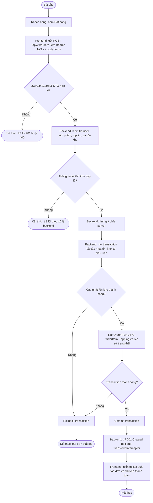

# Activity Diagram: Checkout → Create Order

> Feature: Order | Owner: Tôn Thất Hạnh | Phiên bản: v1
> Khớp với `use-case.md` (UC-06) và `state-machine.md`.

## 1. Sơ đồ

> Sơ đồ PlantUML chuẩn được đặt tại: [`activity-order.puml`](./activity-order.puml)

## 2. Chú thích các làn (swimlane)

| Làn | Trách nhiệm |
|---|---|
| Khách hàng | Kiểm tra giỏ hàng và nhấn nút “Đặt hàng”. |
| Frontend | Gửi request `POST /api/v1/orders` kèm Header `Authorization: Bearer <JWT>` và danh sách `items`; nhận response; hiển thị kết quả hoặc thông báo lỗi phù hợp. |
| Backend | Xác thực JWT (`req.user.sub`), kiểm tra dữ liệu đầu vào theo DTO, kiểm tra sản phẩm, topping và tồn kho; tính giá phía server; tạo đơn hàng trong transaction. |
| Cơ sở dữ liệu (CSDL) | Lưu thông tin `Order`, `OrderItem`, `OrderItemTopping` và lịch sử trạng thái; cập nhật tồn kho; commit hoặc rollback các thay đổi thuộc transaction. |

### Ghi chú

- Backend chịu trách nhiệm tính toán giá và kiểm tra tồn kho; không tin tưởng tổng tiền do Frontend tự gửi lên.
- Việc xác thực JWT chỉ được mô tả là bước bắt buộc khi đã xác nhận endpoint có cấu hình xác thực.
- Các chức năng khuyến mãi và tự động hết hạn đơn không thuộc luồng chính cho đến khi được xác nhận triển khai.

### 3. Đối chiếu Activity ↔ Use Case ↔ State Machine

| Nhánh trong Activity | Use Case | Kết quả với Order |
|---|---|---|
| Dữ liệu đầu vào không hợp lệ | Error flow: dữ liệu tạo đơn không hợp lệ | Request bị từ chối; không tạo đơn thành công. |
| Người dùng không tồn tại hoặc thông tin người dùng không hợp lệ | Error flow: kiểm tra người dùng | Request thất bại theo cơ chế xử lý lỗi của backend; không tạo đơn thành công. |
| Sản phẩm hoặc topping không hợp lệ | Error flow: kiểm tra sản phẩm và topping | Request thất bại; không tạo đơn thành công. |
| Tồn kho không đủ | Error flow: kiểm tra tồn kho | Không tạo đơn thành công; tồn kho không bị cập nhật dở dang. |
| Cập nhật tồn kho hoặc tạo dữ liệu đơn hàng thất bại trong transaction | Error flow: lỗi trong quá trình tạo đơn | Transaction rollback theo thiết kế; không để lại các cập nhật dở dang. |
| Tạo đơn thành công | Main flow: tạo đơn hàng | Tạo `Order` mới với trạng thái `PENDING`; lưu `OrderItem` và lịch sử trạng thái theo implementation hiện tại. |
| Thanh toán thành công | State Machine: `PENDING → PAID` | Chỉ áp dụng khi luồng thanh toán được triển khai và tích hợp. |
| Thanh toán thất bại | State Machine: `PENDING → PAYMENT_FAILED` | Chỉ áp dụng khi luồng thanh toán được triển khai và tích hợp. |
| Hủy đơn | State Machine: chuyển sang `CANCELLED` | Chỉ cho phép khi trạng thái hiện tại và quy tắc nghiệp vụ đáp ứng điều kiện hủy đã thống nhất. |

### Ghi chú

- Mã HTTP cụ thể phải được đối chiếu với exception và cơ chế xử lý lỗi thực tế của backend.
- `PENDING` là trạng thái ban đầu của đơn hàng được tạo thành công.
- Các nhánh thanh toán và hủy đơn mô tả sự liên kết với State Machine, không có nghĩa những API tương ứng đã được triển khai.
- Khi kiểm thử transaction, cần kiểm tra cả dữ liệu đơn hàng và tồn kho trong cơ sở dữ liệu.

## 4. Ghi chú

- **Xử lý transaction:** Việc cập nhật tồn kho và tạo dữ liệu đơn hàng phải được xử lý nhất quán trong transaction. Nếu xảy ra lỗi, các thay đổi thuộc transaction cần được rollback theo thiết kế.
- **Xử lý tồn kho:** Backend sử dụng cập nhật tồn kho có điều kiện để hạn chế tình trạng bán vượt số lượng hiện có. Cơ chế optimistic locking bằng `Product.version` và số lần thử lại chỉ được mô tả khi đã xác nhận có triển khai trong schema và backend.
- **Mã lỗi HTTP:** Mã lỗi cụ thể phụ thuộc vào exception và cơ chế xử lý lỗi thực tế. Không mặc định mọi trường hợp hết hàng hoặc xung đột đồng thời đều trả về `409`.
- **Lỗi hệ thống:** Nếu quá trình tạo đơn thất bại, cần kiểm tra transaction đã rollback và không để lại dữ liệu hoặc cập nhật tồn kho dở dang. Mã `500` chỉ được ghi nhận khi phù hợp với cách backend xử lý lỗi.
- **Hết hạn đơn hàng:** Quy tắc tự động chuyển `PENDING` hoặc `PAYMENT_FAILED` sang `CANCELLED` sau 15 phút chỉ áp dụng khi trường thời hạn và cơ chế tự động xử lý đã được triển khai.
- **Phạm vi Activity Diagram:** Sơ đồ tập trung vào luồng tạo đơn hàng, kết thúc khi Frontend nhận kết quả tạo đơn. Thanh toán, hủy đơn và hết hạn đơn được mô tả riêng trong `state-machine.md` và các tài liệu liên quan.
