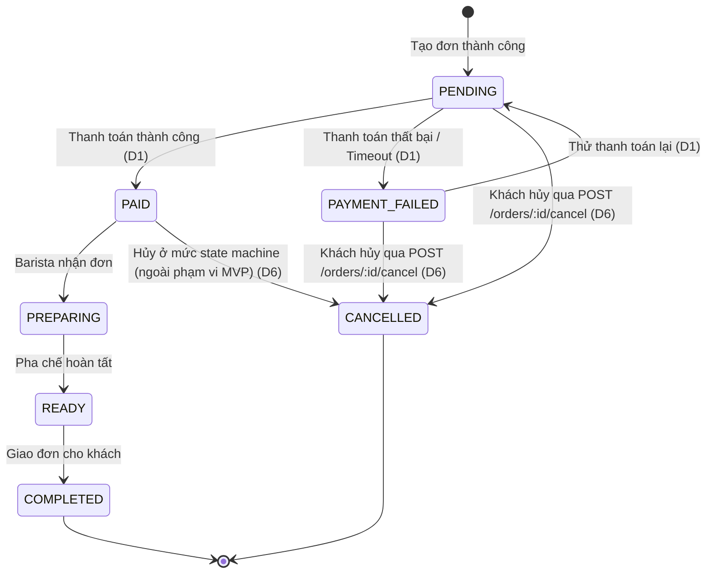

# Order State Machine

> Feature: Order | Owner: Tôn Thất Hạnh | Phiên bản: v1.1 (Aligned with Design Decisions D1, D6, D9)

## 1. Quyết định thiết kế

| # | Quyết định | Trạng thái & Chi tiết |
|---|---|---|
| 1 | Tách hai bước: `POST /orders` tạo đơn ở trạng thái `PENDING`; `POST /payments` xử lý thanh toán và cập nhật trạng thái đơn | **Đã chốt (D1):** Tách biệt tạo đơn và thanh toán. `OrderService.transition` là nơi duy nhất cập nhật `Order.status`. |
| 2 | Giữ tồn kho khi tạo đơn trong transaction; cập nhật tồn kho bằng Optimistic Locking | **Đã chốt (D3):** Trừ kho Product dùng Optimistic Locking (`version`), trừ kho Topping dùng điều kiện `stock >= qty`. |
| 3 | Cho phép `PAYMENT_FAILED → PENDING` để thử thanh toán lại | **Đã chốt (D1):** Không giới hạn số lần thử lại; gỡ bỏ quy định tối đa 3 lần và 15 phút. Mỗi lần thử dùng `Idempotency-Key` mới. |
| 4 | Cho phép hủy đơn từ `PENDING` và `PAYMENT_FAILED` qua endpoint; giữ `PAID → CANCELLED` ở mức State Machine | **Đã chốt (D6):** Khách hàng hủy đơn qua `POST /orders/:id/cancel` (chỉ từ `PENDING` hoặc `PAYMENT_FAILED`). Hoàn tồn kho trong cùng transaction. `PAID → CANCELLED` được giữ trong State Machine theo đề bài PDF nhưng ngoài phạm vi MVP (không làm UI/endpoint/hoàn tiền). |
| 5 | Không dùng scheduler tự động hết hạn đơn hàng trong MVP | **Đã chốt (D6):** Gỡ bỏ scheduler/cron-job 15 phút và trường `expiresAt`. Đơn bỏ dở giữ tồn kho cho đến khi hủy thủ công. |
| 6 | Cộng điểm loyalty tự động khi đơn chuyển sang `PAID` | **Đã chốt (D9):** Tỷ lệ 1 điểm / 1.000đ `finalAmount` (floor). Thực hiện trong cùng transaction với transition sang `PAID`. |
| 7 | Chốt số tiền server-side khi tạo đơn | **Đã chốt (D7):** Backend tính `totalAmount`, `discountAmount`, `finalAmount`. Payment sử dụng `finalAmount` lưu trong DB. |

## 2. Sơ đồ trạng thái (State Diagram)

Sơ đồ phản ánh chính xác 10 chuyển tiếp hợp lệ theo đề bài gốc (trang 8 PDF `BrewLite-CongNghePhanMem.pdf`):



**Trạng thái kết thúc:** `COMPLETED`, `CANCELLED`.

## 3. Danh sách trạng thái

| Trạng thái | Ý nghĩa | Trạng thái kết thúc? |
|---|---|---|
| `PENDING` | Đơn hàng đã được tạo thành công và đang chờ thanh toán. | Không |
| `PAYMENT_FAILED` | Lần thanh toán gần nhất thất bại. Khách hàng có thể thử lại không giới hạn hoặc hủy đơn. | Không |
| `PAID` | Đơn hàng đã thanh toán thành công, chờ được tiếp nhận để pha chế. | Không |
| `PREPARING` | Barista đang pha chế đơn hàng. | Không |
| `READY` | Đơn hàng đã pha chế xong, chờ khách nhận. | Không |
| `COMPLETED` | Đơn hàng đã được giao cho khách và hoàn tất quy trình. | Có |
| `CANCELLED` | Đơn hàng đã bị hủy. | Có |

## 4. Bảng chuyển tiếp hợp lệ (Transition Table - Đủ 10 chuyển tiếp chuẩn PDF)

Hệ thống cài đặt hàm `assertTransition(from, to)` để kiểm tra tính hợp lệ trước khi cập nhật. Đúng 10 chuyển tiếp sau được chấp nhận:

| # | Từ | Sang | Sự kiện | Tác nhân | Tác động phụ thực thi trong transaction |
|---|---|---|---|---|---|
| **T1** | (start) | `PENDING` | Tạo đơn thành công | Khách hàng | Validate DTO, tính giá server-side, trừ/giữ tồn kho (Product optimistic lock + Topping conditional), tạo Order và OrderItems. |
| **T2** | `PENDING` | `PAID` | Thanh toán thành công | Cổng thanh toán / System | Ghi nhận thanh toán `SUCCESS`, cập nhật `paidAt = now()`, cộng điểm loyalty (`Order.pointsEarned`, `User.loyaltyPoints`, tạo `LoyaltyTransaction` EARNED). |
| **T3** | `PENDING` | `PAYMENT_FAILED` | Thanh toán thất bại hoặc timeout | Cổng thanh toán / System | Ghi nhận Payment `FAILED`, lưu `failureReason`. Giữ nguyên tồn kho và giỏ hàng client để khách thử lại. |
| **T4** | `PENDING` | `CANCELLED` | Khách hủy đơn | Khách hàng (`POST /orders/:id/cancel`) | Hoàn lại tồn kho cho Product và Topping; ghi `OrderStatusHistory`. |
| **T5** | `PAYMENT_FAILED` | `PENDING` | Thử thanh toán lại | Khách hàng | Khách bấm "Thử lại", hệ thống chuyển về `PENDING` để nhận thanh toán với `Idempotency-Key` mới. |
| **T6** | `PAYMENT_FAILED` | `CANCELLED` | Khách hủy đơn | Khách hàng (`POST /orders/:id/cancel`) | Hoàn lại tồn kho cho Product và Topping; ghi `OrderStatusHistory`. |
| **T7** | `PAID` | `PREPARING` | Tiếp nhận đơn để pha chế | Barista / Quản lý | Cập nhật trạng thái đơn sang pha chế. |
| **T8** | `PAID` | `CANCELLED` | Hủy đơn đã thanh toán | State Machine / Service | **Chỉ tồn tại trong State Machine/Service** (chuẩn hóa theo PDF đề bài). Ngoài phạm vi MVP: không có endpoint/UI, không hỗ trợ hoàn tiền tự động. |
| **T9** | `PREPARING` | `READY` | Pha chế hoàn tất | Barista / Quản lý | Cập nhật trạng thái thông báo khách nhận đồ uống. |
| **T10** | `READY` | `COMPLETED` | Giao đơn cho khách | Barista / Quản lý | Hoàn tất đơn hàng. |

### Quy tắc chuyển trạng thái
- Mọi chuyển tiếp ngoài 10 chuyển tiếp trên đều bị chặn bởi `assertTransition` và ném lỗi `409 Conflict`.
- `COMPLETED` và `CANCELLED` là trạng thái kết thúc, không có bất kỳ chuyển tiếp nào đi tiếp.

## 5. State Rules & Cơ chế thực thi

1. **Một luồng chuyển trạng thái duy nhất:** Mọi cập nhật trạng thái đơn hàng bắt buộc phải đi qua hàm `OrderService.transition(orderId, to)`. Các module khác (kể cả Payment) **tuyệt đối không tự cập nhật trực tiếp `Order.status`**.
2. **Cập nhật có điều kiện và chống xung đột (Conditional update):** Khi chuyển trạng thái, câu lệnh cập nhật phải kèm điều kiện:
   ```sql
   WHERE id = :orderId AND status = :fromStatus AND version = :version
   ```
   Nếu cập nhật trả về 0 bản ghi, hệ thống ném `409 Conflict`.
3. **Ghi lịch sử trạng thái:** Mỗi lần gọi `OrderService.transition`, một bản ghi `OrderStatusHistory` phải được tạo trong cùng transaction.
4. **Quy tắc cộng điểm thưởng Loyalty (D9):** Khi chuyển trạng thái sang `PAID` (chuyển tiếp T2):
   - Tính điểm: `points = Math.floor(finalAmount / 1000)`.
   - Cập nhật `Order.pointsEarned = points`, `User.loyaltyPoints = User.loyaltyPoints + points`.
   - Tạo bản ghi `LoyaltyTransaction` loại `EARNED` với `orderId`. Đảm bảo tính idempotent: chỉ tạo đúng 1 giao dịch tích điểm cho mỗi `orderId`.
   - Không cộng điểm cho các trạng thái `PAYMENT_FAILED` hoặc `CANCELLED`.
5. **Giới hạn đã biết (Known Limitations - D6):** 
   - MVP không cài đặt scheduler tự động hủy đơn sau 15 phút.
   - Các đơn hàng ở `PENDING` hoặc `PAYMENT_FAILED` nếu khách hàng không tiếp tục sẽ tiếp tục giữ tồn kho cho đến khi được hủy thủ công bằng `POST /orders/:id/cancel`.

## 6. Điểm cần xử lý (Open Item)

- **Lệch schema tại `OrderStatusHistory.fromStatus`:**
  - Trong `schema.prisma`, trường `fromStatus OrderStatus` là bắt buộc (không nullable).
  - Tuy nhiên, khi tạo đơn hàng mới (`(start) → PENDING`), trạng thái ban đầu chưa có trạng thái trước (`fromStatus: null`).
  - **Đề xuất giải pháp:** Giữ nguyên schema hiện tại trong tài liệu này; Backend Owner sẽ tạo một migration riêng để sửa trường này thành nullable (`fromStatus OrderStatus?`). Không sửa schema trong nhánh tài liệu.

## 7. Lịch sử thay đổi
- v1.0 (2026-10-09): Khởi tạo tài liệu Order State Machine.
- v1.1 – áp dụng quyết định D1, D6, D9 (ngày 2026-10-16).

