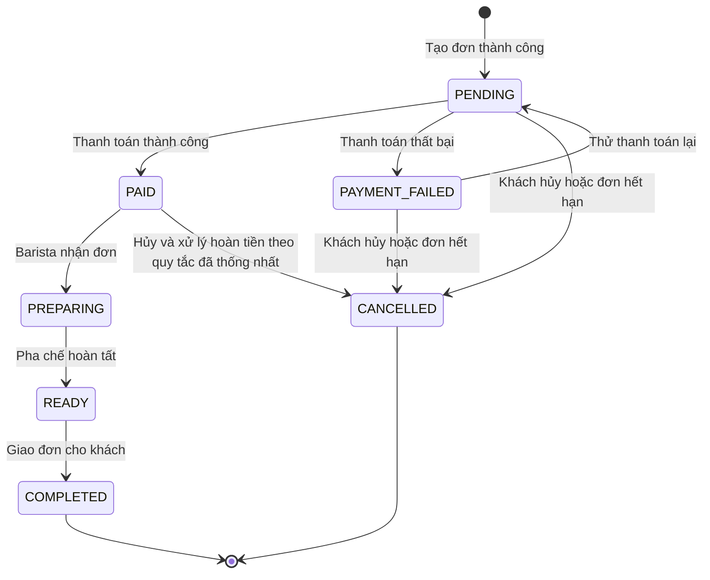

# Order State Machine

> Feature: Order | Owner: Tôn Thất Hạnh | Phiên bản: v1 (Design Baseline)

## 1. Quyết định thiết kế

| # | Quyết định | Lý do / Trạng thái |
|---|---|---|
| 1 | Tách hai bước: `POST /orders` tạo đơn ở trạng thái `PENDING`; `POST /payments` xử lý thanh toán và cập nhật trạng thái đơn | Tách biệt tạo đơn và thanh toán, hỗ trợ thiết kế thử thanh toán lại. Cần xác nhận với nhóm Payment. |
| 2 | Giữ tồn kho khi tạo đơn, trong transaction cùng quá trình tạo đơn; cập nhật tồn kho bằng thao tác có điều kiện | Hạn chế bán vượt tồn kho. Optimistic locking bằng `Product.version` chỉ áp dụng nếu schema và backend thực sự hỗ trợ. |
| 3 | Cho phép `PAYMENT_FAILED → PENDING` để thử thanh toán lại | Hỗ trợ thử lại trên cùng một đơn. Cần thống nhất điều kiện thử lại và idempotency với nhóm Payment. |
| 4 | Thiết kế cho phép hủy từ `PENDING`, `PAYMENT_FAILED`, `PAID`; không cho hủy từ `PREPARING` trở đi | Hủy đơn `PAID` cần xử lý hoàn tiền, tồn kho và điểm loyalty theo quy tắc được nhóm thống nhất. |
| 5 | Dự kiến tự động chuyển đơn `PENDING` hoặc `PAYMENT_FAILED` sang `CANCELLED` sau 15 phút nếu chưa thanh toán | Tránh giữ tồn kho vô thời hạn. Cần xác nhận `expiresAt` và scheduler. |
| 6 | Dự kiến cộng điểm loyalty khi đơn chuyển sang `PAID` | Cần thống nhất cơ chế cập nhật điểm và tính nhất quán dữ liệu với nhóm phụ trách loyalty/payment. |
| 7 | Dự kiến chốt số tiền khi tạo đơn; thanh toán sử dụng số tiền đã được backend lưu | Tránh để client tự thay đổi số tiền. Cần xác nhận quy tắc khuyến mãi và trường tiền giữa Order và Payment. |

> Các quyết định trên mô tả thiết kế dự kiến. Chỉ đánh dấu là đã chốt hoặc đã triển khai sau khi nhóm xác nhận và đối chiếu mã nguồn.

## 2. Sơ đồ trạng thái

Sơ đồ dưới đây thể hiện State Machine theo thiết kế dự kiến. Các chuyển tiếp liên quan đến thanh toán, hủy đơn, hoàn tiền và tự động hết hạn cần được xác nhận với nhóm và đối chiếu với backend trước khi xem là đã triển khai.

**Trạng thái kết thúc:** `COMPLETED`, `CANCELLED`.

**Lưu ý:** Sơ đồ mô tả quy tắc nghiệp vụ dự kiến, không xác nhận rằng toàn bộ các chuyển tiếp đã được triển khai trong backend. Việc chuyển sang `CANCELLED` từ `PAID` cần thống nhất rõ cách xử lý hoàn tiền, tồn kho và điểm loyalty.

Trạng thái kết thúc: `COMPLETED`, `CANCELLED`.

## 3. Danh sách trạng thái

| Trạng thái | Ý nghĩa | Trạng thái kết thúc? |
|---|---|---|
| `PENDING` | Đơn hàng đã được tạo thành công và đang chờ thanh toán. | Không |
| `PAYMENT_FAILED` | Lần thanh toán gần nhất thất bại. Việc thử thanh toán lại và duy trì tồn kho cần tuân theo quy tắc đã thống nhất với nhóm Payment. | Không |
| `PAID` | Đơn hàng đã thanh toán thành công, chờ được tiếp nhận để pha chế. | Không |
| `PREPARING` | Barista đang pha chế đơn hàng. | Không |
| `READY` | Đơn hàng đã pha chế xong, chờ khách nhận. | Không |
| `COMPLETED` | Đơn hàng đã được giao cho khách và hoàn tất quy trình. | Có |
| `CANCELLED` | Đơn hàng đã bị hủy hoặc hết hạn theo quy tắc nghiệp vụ được triển khai. | Có |

### Ghi chú

- Đơn tạo thành công bắt đầu ở trạng thái `PENDING`.
- `PAYMENT_FAILED → PENDING` là chuyển tiếp dự kiến để thử thanh toán lại; cần xác nhận với nhóm Payment.
- `CANCELLED` là trạng thái kết thúc. Việc hoàn tồn kho, hoàn tiền hoặc điều chỉnh điểm loyalty phụ thuộc vào trạng thái trước khi hủy và quy tắc nghiệp vụ đã thống nhất.
- Danh sách trên là State Machine theo thiết kế. Cần đối chiếu enum `OrderStatus` trong `backend/prisma/schema.prisma` để xác nhận các trạng thái thực sự có trong hệ thống.

## 4. Bảng chuyển tiếp hợp lệ (Transition table)

Bảng dưới đây mô tả các chuyển tiếp trạng thái theo thiết kế dự kiến. Các chuyển tiếp liên quan đến thanh toán, hủy đơn và hết hạn cần được xác nhận với nhóm phụ trách trước khi triển khai hoặc kiểm thử tích hợp.

| # | Từ | Sang | Sự kiện | Tác nhân dự kiến | Tác động phụ dự kiến |
|---|---|---|---|---|---|
| T1 | (start) | `PENDING` | Tạo đơn thành công | Khách hàng / hệ thống | Kiểm tra dữ liệu, tính giá phía server, cập nhật tồn kho và tạo đơn trong transaction. |
| T2 | `PENDING` | `PAID` | Thanh toán thành công | Hệ thống thanh toán | Ghi nhận kết quả thanh toán; cộng điểm loyalty nếu nghiệp vụ và cơ chế tích hợp đã được thống nhất. |
| T3 | `PENDING` | `PAYMENT_FAILED` | Thanh toán thất bại | Hệ thống thanh toán | Ghi nhận kết quả thanh toán thất bại; cách xử lý tồn kho cần theo quy tắc đã thống nhất. |
| T4 | `PENDING` | `CANCELLED` | Khách hủy hoặc đơn hết hạn | Khách hàng / scheduler | Giải phóng tồn kho nếu trước đó đã giữ tồn kho; scheduler chỉ áp dụng khi được triển khai. |
| T5 | `PAYMENT_FAILED` | `PENDING` | Thử thanh toán lại | Khách hàng / hệ thống | Kiểm tra điều kiện thử lại, thời hạn đơn và tính idempotent theo thiết kế Payment đã thống nhất. |
| T6 | `PAYMENT_FAILED` | `CANCELLED` | Khách hủy hoặc đơn hết hạn | Khách hàng / scheduler | Giải phóng tồn kho nếu cần; tự động hết hạn chỉ áp dụng khi được triển khai. |
| T7 | `PAID` | `PREPARING` | Tiếp nhận đơn để pha chế | Barista | Chưa xác nhận thuộc phạm vi MVP. |
| T8 | `PAID` | `CANCELLED` | Hủy đơn đã thanh toán | Khách hàng / quản lý có thẩm quyền | Cần thống nhất quy trình hoàn tiền, tồn kho và điều chỉnh điểm loyalty trước khi triển khai. |
| T9 | `PREPARING` | `READY` | Pha chế hoàn tất | Barista | Cập nhật trạng thái đơn. |
| T10 | `READY` | `COMPLETED` | Giao đơn cho khách | Barista / nhân viên giao đơn | Cập nhật trạng thái hoàn tất. |

### Quy tắc chuyển trạng thái

- Chỉ cho phép các chuyển tiếp được nhóm thống nhất và được triển khai trong State Machine.
- Các cặp chuyển trạng thái không được cho phép phải bị từ chối; mã HTTP cụ thể cần đối chiếu với exception và cơ chế xử lý lỗi thực tế. `409 Conflict` là mã dự kiến nếu backend sử dụng quy ước này.
- `COMPLETED` và `CANCELLED` là trạng thái kết thúc, không có chuyển tiếp hợp lệ đi tiếp theo thiết kế hiện tại.
- Việc kiểm tra toàn bộ cặp trạng thái hợp lệ và không hợp lệ được thực hiện theo ma trận State Machine trong `test-cases.md`.

### Ghi chú

Bảng này là đặc tả nghiệp vụ dự kiến, không phải bằng chứng rằng mọi API hoặc tác động phụ đã được triển khai. Cần xác nhận với nhóm Payment, Product, Barista và các thành viên phụ trách loyalty trước khi chốt các quy tắc liên quan.

## 5. State rules

1. **Một luồng chuyển trạng thái thống nhất:** Theo thiết kế, mọi thay đổi trạng thái đơn hàng cần đi qua một cơ chế chuyển trạng thái tập trung, chẳng hạn `OrderService.transition(orderId, to)`, và kiểm tra tính hợp lệ bằng `assertTransition(from, to)` trước khi cập nhật. Cần đối chiếu với implementation thực tế để xác nhận cơ chế này đã tồn tại.

2. **Cập nhật có điều kiện:** Khi cập nhật trạng thái, backend nên kiểm tra trạng thái hiện tại của đơn để tránh hai request cạnh tranh ghi đè lẫn nhau. Có thể dùng cập nhật có điều kiện tương đương `WHERE id = :id AND status = :from`. Đây là yêu cầu thiết kế cần xác minh trong code; nếu không cập nhật được bản ghi, backend phải xử lý tình huống xung đột phù hợp.

3. **Trạng thái kết thúc:** Theo State Machine hiện tại, `COMPLETED` và `CANCELLED` là các trạng thái kết thúc. Không cho phép chuyển tiếp sang trạng thái khác sau khi đơn đã đạt một trong hai trạng thái này.

4. **Hết hạn đơn hàng:** Dự kiến đơn `PENDING` hoặc `PAYMENT_FAILED` chưa thanh toán sẽ hết hạn sau 15 phút. Việc triển khai cần có cơ chế xác định thời điểm hết hạn, xử lý tự động và giải phóng tồn kho phù hợp. Không xem quy tắc này là chức năng đã có cho đến khi xác nhận trường dữ liệu và scheduler trong backend.

5. **Tiền, hoàn tiền và điểm loyalty:** Backend phải tính toán số tiền dựa trên dữ liệu đáng tin cậy. Việc cộng điểm khi chuyển sang `PAID`, hoàn tiền khi hủy đơn đã thanh toán và điều chỉnh điểm loyalty phải tuân theo quy tắc nghiệp vụ được nhóm thống nhất. Không giả định các tác động phụ này đã được triển khai nếu chưa kiểm tra code.

6. **Lịch sử trạng thái:** Khuyến nghị ghi nhận lịch sử mỗi lần chuyển trạng thái, gồm mã đơn, trạng thái trước

## 6. Schema cần đối chiếu

Đối chiếu các yêu cầu của State Machine với file `backend/prisma/schema.prisma` và implementation liên quan trước khi xác nhận thiết kế đã được triển khai.

| Thành phần | Nội dung cần kiểm tra | Hướng xử lý nếu chưa đáp ứng |
|---|---|---|
| Enum `OrderStatus` | Kiểm tra có đủ 7 trạng thái `PENDING`, `PAYMENT_FAILED`, `PAID`, `PREPARING`, `READY`, `COMPLETED`, `CANCELLED` hay không. | Trao đổi với Leader và nhóm phụ trách để thống nhất State Machine trước khi đề xuất thay đổi schema. |
| `Order.expiresAt` | Kiểm tra trường thời hạn thanh toán có tồn tại hay không, nếu nhóm triển khai tự động hết hạn sau 15 phút. | Chỉ đề xuất bổ sung khi quy tắc hết hạn và cơ chế xử lý tự động đã được thống nhất. |
| Trường tồn kho của `Product` | Kiểm tra tên và kiểu dữ liệu của trường tồn kho thực tế, cùng cách backend cập nhật trường này. | Đối chiếu với logic tạo đơn và cập nhật tồn kho hiện có; không tự giả định tên trường là `stock`. |
| `Product.version` | Kiểm tra trường phiên bản có tồn tại hay không nếu nhóm chọn optimistic locking dựa trên phiên bản. | Chỉ đề xuất bổ sung nếu nhóm thống nhất sử dụng cơ chế này và backend cần trường phiên bản. |
| Lịch sử trạng thái đơn hàng | Kiểm tra model hoặc bảng lưu lịch sử chuyển trạng thái, ví dụ `OrderStatusHistory`, nếu có. | Nếu chưa có, trao đổi với nhóm về nhu cầu truy vết trước khi đề xuất thay đổi schema. |
| Quan hệ `Order` – `OrderItem` | Kiểm tra quan hệ giữa đơn hàng và các dòng sản phẩm, gồm các trường cần thiết để lưu sản phẩm, kích thước, số lượng và giá tại thời điểm đặt hàng. | Đối chiếu với DTO, service tạo đơn và cấu trúc response thực tế. |
| Quan hệ thanh toán – đơn hàng | Kiểm tra model thanh toán, quan hệ với đơn hàng và cách lưu kết quả thanh toán nếu luồng Payment được triển khai. | Phối hợp với nhóm Payment để thống nhất cấu trúc dữ liệu và cách cập nhật trạng thái. |

### Kết luận kiểm tra schema

- Các thành phần trong bảng là những nội dung cần đối chiếu, không phải khẳng định rằng trường hoặc model tương ứng đã tồn tại.
- Phân biệt rõ **schema hiện tại**, **implementation hiện tại** và **yêu cầu thiết kế dự kiến**.
- Nếu phát hiện thiếu sót, ghi nhận nội dung, mức độ ảnh hưởng và báo Leader (Minh Chiến) để thống nhất phương án xử lý.
- Không tự sửa schema trong nhánh tài liệu (`docs`). Mọi thay đổi schema cần được nhóm phụ trách phê duyệt và thực hiện theo quy trình của dự án.
